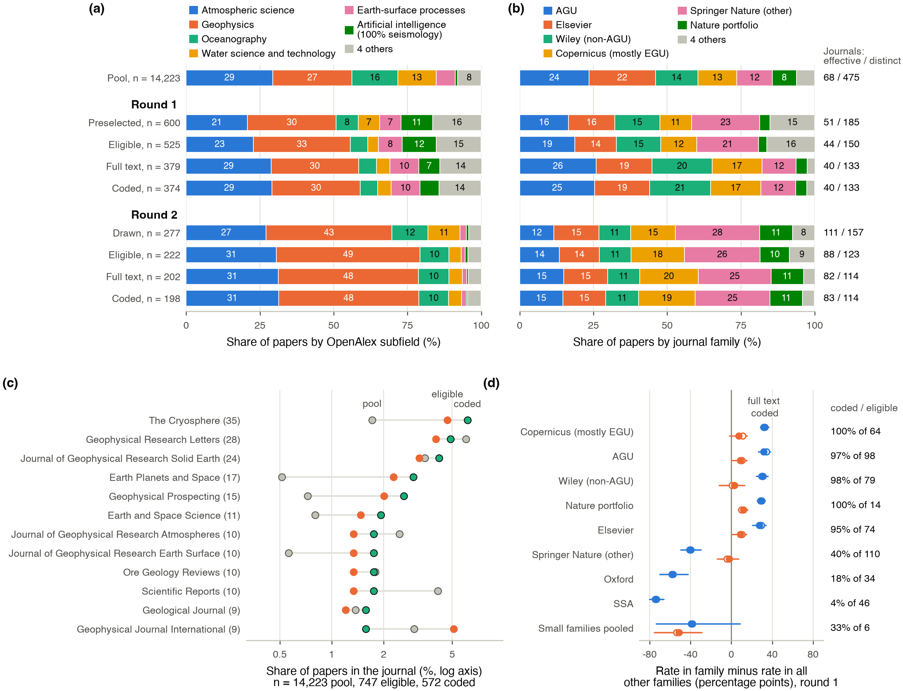
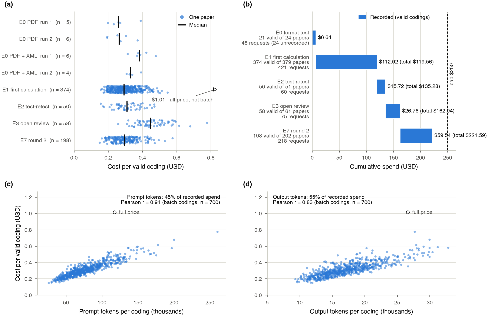
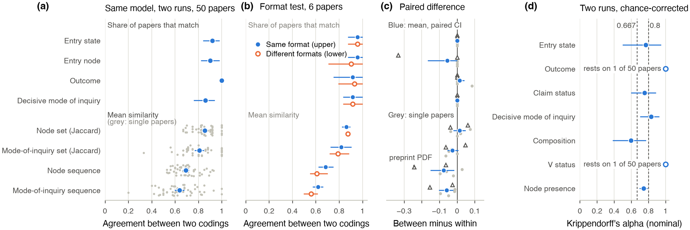
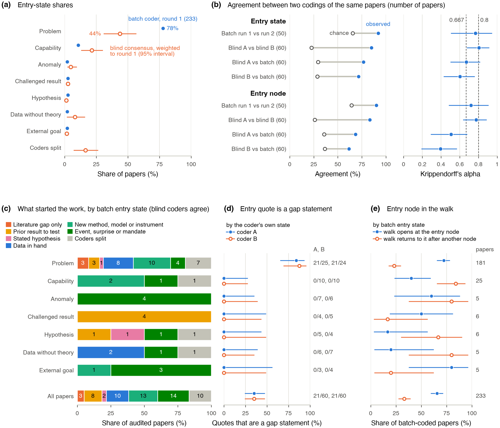
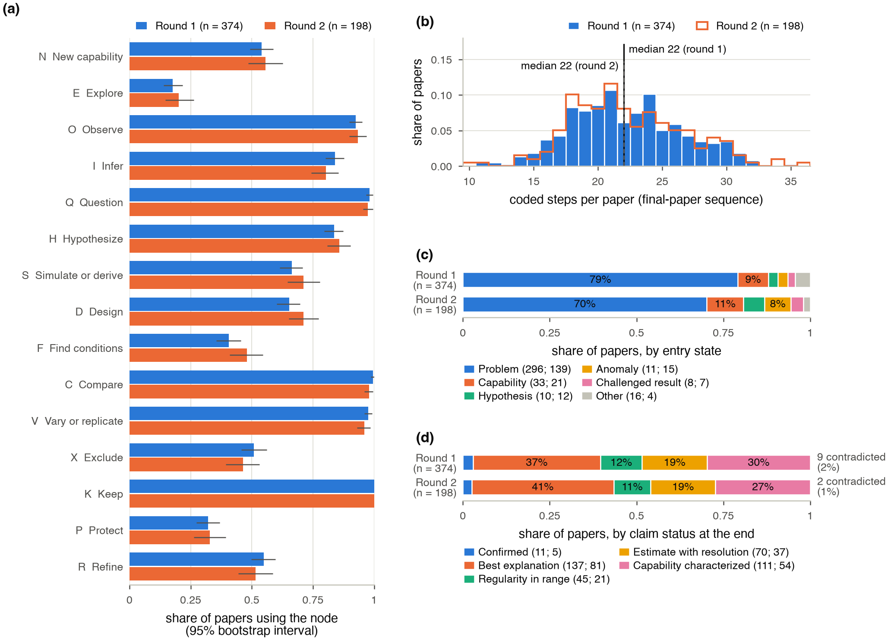
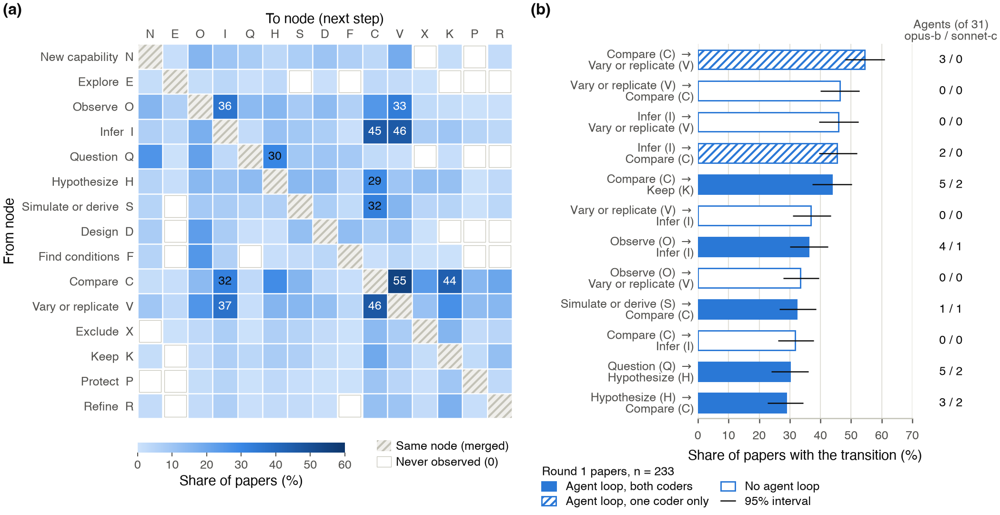
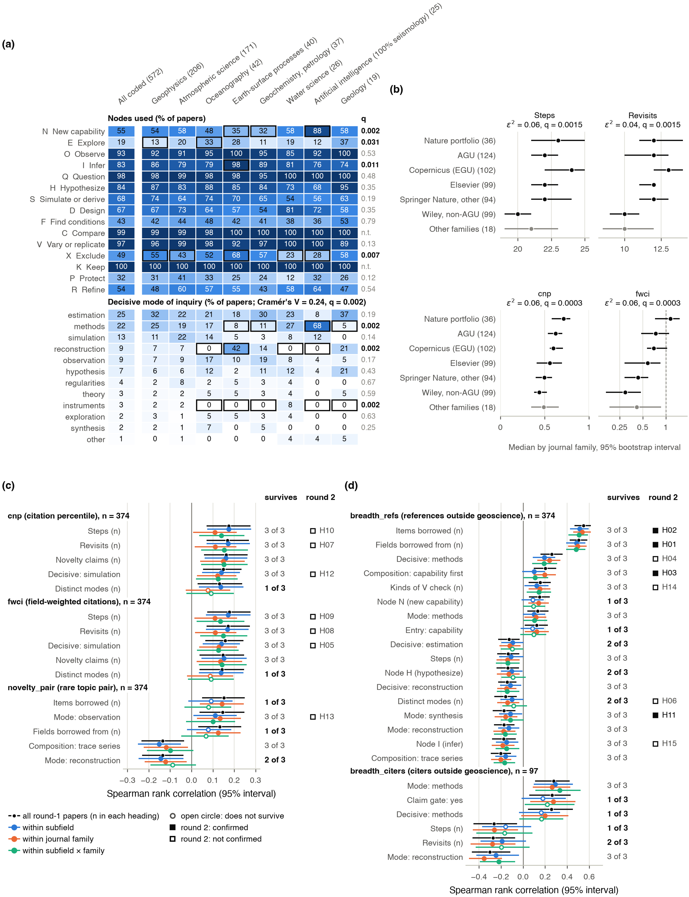
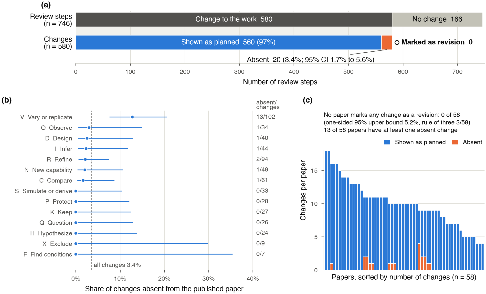
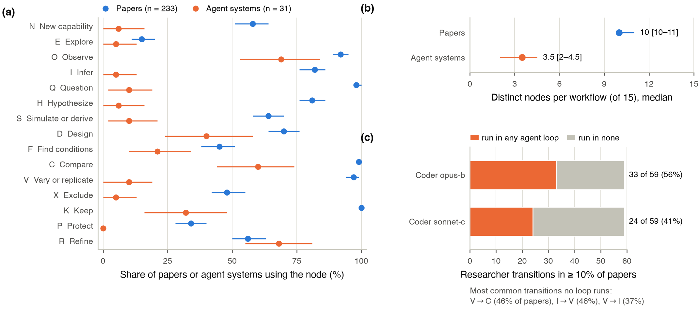

# How Earth-science papers describe their research workflows: the roadmap experiments, round 1

Draft v0.2, October 27, 2026. Denolle Lab metascience project. The *roadmap* is the lab's staged plan for measuring inquiry in published papers (`private/analysis/roadmap-plurality-loops.md`); this report covers Phase 0 (a measurement instrument and its reliability), the first round of the corpus study, and Phase 2b (what reporting removes, here the work done in peer review).
Status: model-coded throughout; no human coding has been scored against the model yet.

**State at writing.** Every result below rests on the codings that passed validation on October 27, 2026: 233 round-1 papers (tag `calc1`) and 0 round-2 papers (tag `r2`). Three coding batches were still running: 154 and 48 round-2 papers, and a top-up of 146 round-1 papers: 144 whose full text arrived after the first batch and the 2 whose first coding failed validation. When they return, the scripts of section 11 recompute every number and figure from the valid codings, and the text will be revised to match. Every n will change, and some results with it.

## Summary

We asked a large language model to read 2022 Earth-science papers and write down each paper's research workflow as a walk on a graph. The graph's vertices (*nodes*) are fifteen kinds of research move, such as question, observe, infer, compare, and vary and replicate. Each step also carries one of thirteen *modes*, the style of inquiry it serves (estimation, reconstruction, methods, and so on). The coder is Claude Opus 5.5 (`claude-opus-5-5`) under codebook 1.5.0; every step of a coding must cite a page or paragraph locator and a quote of at most 25 words. From an OpenAlex pool of 14,223 candidate papers, round 1 preselected 600, kept 525 after an abstract screen, had full text for 235 at the time of coding, and obtained 233 valid codings.

Terms used in the bullets, defined fully in sections 3 to 7: *entry state*, what started the work as the paper tells it; *decisive mode*, the mode of the one step without which the main claim would not exist; *composition*, a named overall pattern of the walk; *Krippendorff's alpha*, agreement corrected for chance (1 perfect, 0 chance); *q*, a p value adjusted for many tests (Benjamini-Hochberg false discovery rate); *rho*, Spearman rank correlation; *cnp*, a citation percentile within the paper's OpenAlex subfield and year; *agent loop*, the cycle an AI research system repeats.

- **The coder agrees with itself on most fields; agreement with human coders is not yet measured.** Coding 50 papers twice gave alpha 0.83 for decisive mode (95% bootstrap interval 0.70 to 0.93), 0.77 for entry state (0.50 to 0.95), 0.74 for which nodes a paper uses (0.70 to 0.79) and 0.60 for composition (0.38 to 0.77). Raw agreement on entry state is 92%, but 78% of papers carry its most common label. Outcome and V status (whether the paper checks its own result) cannot be scored this way: 49 of 50 papers fall in one class. Two codings of the same paper overlap more than codings of two different papers, though less than the raw numbers suggest: node-set overlap 0.86 against 0.65 for two different papers.
- **Most papers share a core of moves.** Nearly every paper questions, compares, varies or replicates, and keeps a claim. The median paper has 22 coded steps and returns to modes it has already used. Only 1 of 233 contains the textbook order question, hypothesis, simulate, design, find conditions, observe, compare, even with other steps allowed in between.
- **Field and venue shape the workflow.** 28 of 104 tests of workflow against OpenAlex subfield or journal family have q < 0.1. Seismology papers that OpenAlex files under the subfield Artificial Intelligence are built around a new method, Earth-Surface Processes papers around reconstruction from traces, and AGU and Copernicus papers have longer workflows than the other Wiley journals. The AGU contrast rests on 16 papers that are not a random draw from AGU.
- **A few workflow features track citations and breadth, and venue explains part of the citation link.** 15 of 245 feature-outcome tests have q < 0.1; none passes the stricter Benjamini-Yekutieli correction, which allows any dependence among tests. Longer workflows go with higher citation percentile (rho 0.23; 0.17 with reference count held fixed; 0.12 within journal family). The largest correlation, between the number of items the coder lists as borrowed from other fields and the share of references outside geoscience (rho 0.57), is a check that the coder reads the papers consistently with their reference lists, not an outcome result.
- **Review changes enter the paper unattributed.** Of 580 review-driven changes in 58 Copernicus papers with open discussion (33 in The Cryosphere), 560 read as planned, 20 are absent, and none is marked as a revision.
- **Published agent designs include few of the moves papers report most often.** Against 31 published agent designs, the largest gaps are at question (98% of papers, 10% of agent systems), vary or replicate (97% against 10%), infer (82% against 5%) and hypothesize rivals (81% against 6%). The gaps hold for the 14 research systems alone, and papers and agents were coded from different kinds of text.
- **The sample is set by full-text access.** Coded papers are concentrated in a few venues: The Cryosphere alone is 14% of them, and every eligible Copernicus paper was coded while 16 of 98 AGU papers were. The pending batches should reduce this skew.

Recorded model spend for all experiments to date: $123.59 of a $250 cap; $0.32 per paper for the main coding.

## 1. Question, and why it matters to two fields

Two problems motivate the roadmap. Experts reach different conclusions from the same data, and much of the inquiry behind a paper never reaches the paper. The roadmap measures what papers say about how their research was done, and codes it so that human workflows and AI agent loops can be compared on the same graph.

**For geoscientists.** Much of Earth science works with conditions found in nature rather than set in a laboratory. An earthquake, a glacier or a storm cannot be rerun, so the field relies on reconstruction from traces, on nature repeating itself across events, and on checks such as synthetic tests (running a method on simulated data with a known answer), independent stations or a second inversion method (inversion: estimating unobserved Earth properties from measurements by fitting a physical model). Laboratory work (experimental petrology, rock mechanics, geochemistry) and numerical experiments set their own conditions, and there controls and replication take their usual meaning. Whether published papers show those checks, and whether the shape of a workflow relates to how a paper is cited or how far it reaches outside the field, are questions about the field's own practice. They can be asked at scale only if reading papers can be automated with known error.

**For NLP and AI researchers.** Research agents such as The AI Scientist (Lu et al., 2026), Coscientist (Boiko et al., 2023) and the AI co-scientist (Gottweis et al., 2026) are designed and evaluated mostly from what published papers report. If papers present the workflow selectively, agents learn a cleaner process than the one people follow. This study is also an annotation experiment: a large language model (Claude Opus 5.5) as annotator of a long, technical, structured coding task (one JSON object with dozens of fields per paper), with measured test-retest consistency, an input-format ablation (rerunning with one input changed), validation by a deterministic checker (a script, not a model), and cost per document.

Five questions organize the report:

1. How consistently does the model code workflows (section 4)?
2. What do Earth-science workflows look like on the graph (section 5)?
3. Do workflows differ by field and venue (section 6)?
4. Do workflow features relate to citation, novelty and breadth, and does field or venue explain that (section 7)?
5. What does the paper leave out: the work done in peer review (section 8) and the moves AI agents skip (section 9)?

## 2. Corpus


*Figure 1.* Stages of both rounds and screening exclusions.

**Notation.** Numbers in square brackets are 95% percentile bootstrap intervals: the statistic recomputed on 2,000 samples of papers drawn with replacement, unless a section says otherwise. *q* is a p value adjusted by the Benjamini-Hochberg procedure for the number of tests in its family (Benjamini & Hochberg, 1995; section 6): among results with q < 0.1, about 10% are expected to be false on average. *cnp* is the OpenAlex citation normalized percentile, a paper's citation count as a percentile among works of the same OpenAlex subfield, year and type (0 to 1); the other outcome metrics are defined in section 7.

**Pool.** We drew from OpenAlex, an open bibliographic index that supplies each paper's journal, publisher, citation counts and machine-assigned topic labels (Priem et al., 2022). The pool is every 2022 journal article with an abstract and at least 15 references in Earth-science venues that have a full-text route, split into a "core" ring (the eight OpenAlex topics of the convenor, M. Denolle, who runs the seminar and the project) and a "broad" ring (eight neighbouring Earth-science subfields): 14,223 papers (`g02_pool.py`). Papers with a convenor co-author are excluded from both draws.

**Round 1.** 600 papers preselected, 300 per ring, with equal numbers per cnp quintile (120 per quintile) and, within a quintile, subfields taken in turn (`g03_preselect.py`, seed 2026). The design makes the citation distribution near-uniform (sample median cnp 0.55, pool median 0.75) and raises small subfields: the OpenAlex subfield Artificial Intelligence, which in this pool holds only the core-ring topic Seismology and Earthquake Studies, is 0.8% of the pool and 11% of the preselection.

**Round 2.** 277 open-access papers drawn from the rest of the pool, at most 4 per journal, round robin over publishers (`g18_round2_draw.py`, seed 2027): 157 journals, 12 publishers.

**Screen.** Each abstract went to two independent model screeners, with a third model call settling disagreement or uncertainty (16 of 600 adjudicated in round 1, 4 of 277 in round 2). The screeners are Claude agents in a Claude Code workflow (`tools/roadmap/workflows/gold-eligibility-screen.js`, effort medium); the workflow does not set or record the model version. In NLP terms this is double annotation with adjudication; in a systematic review it is the eligibility step. It drops off-topic papers, reviews, and comments or replies, since the codebook codes research workflows. Round 1 kept 525 of 600 (87.5%; 54 off-topic, 12 reviews, 5 comments or replies, 4 other). Round 2 kept 222 of 277 (80.1%); the screeners agreed on 275 of 277.


*Figure 2.* Full text by publisher (PDF, publisher XML) and open-access share.

**Full text.** The coder needs the whole paper. At the first coding (October 25), 235 of 525 round-1 papers had a PDF. A re-fetch on October 27 from the University of Washington network, with the Wiley route corrected for AGU DOIs, added 192 PDFs across both rounds (144 round 1, 48 round 2; Wiley 106, Elsevier 85, Springer 1) and 103 Elsevier XML files (74 round 1, 29 round 2; `refetch_2026-10-27.log`). Round 1 now has a PDF for 379 of 525 (72.2%) and text of either kind for 381; round 2 has 202 of 222 (91%), high by design because it was drawn from open-access papers. Round-1 papers still without a PDF are mostly in journals of the Seismological Society of America (SSA: the Bulletin of the Seismological Society of America and Seismological Research Letters, 44), English translations of Russian-language journals that Pleiades (43) and Allerton Press (11) publish and Springer distributes, and Geophysical Journal International (GJI, Oxford University Press, 28). Publisher XML matters for NLP readers because it gives section-and-paragraph locators, so every quote can be found by string search; it exists for 190 round-1 papers now, and 116 of the 233 coded papers were coded with it (section 3).


*Figure 3.* Outcome metrics and open-access share by stage, and the coverage effect.

**Who got coded.** Full-text access filters the sample. In round 1, 83% of the 233 coded papers are open access, against 46% of the 292 eligible papers not coded, a difference of 37 percentage points [30, 45]. The cnp of coded papers is slightly higher (median difference +0.07 [−0.01, +0.18]). Topic-pair rarity (novelty_pair) and the share of references outside geoscience (breadth_refs) do not differ.



*Figure 4.* Subfield and journal family at each stage, the most frequent journals, and coverage by family.

**Journals and topics.** Two groupings are used throughout. *Subfield* is the OpenAlex subfield of the paper's leading topic. OpenAlex assigns topics with a classifier over title, abstract, venue and citations; topics nest in subfields (Geophysics, Atmospheric Science, Oceanography) and fields (Earth and Planetary Sciences, Environmental Science). These are machine labels, not author keywords, and the subfield names can mislead:

- OpenAlex files the topic Seismology and Earthquake Studies under the subfield Artificial Intelligence, in the field Computer Science. Here that subfield holds only this topic: 17 coded seismology papers, 13 of which have machine-learning (ML) terms somewhere in their coding and 6 in a new-capability step. This report calls it "Seismology (OpenAlex: Artificial Intelligence)"; the figures label it "Artificial intelligence (100% seismology)".
- As coded, Atmospheric Science is 72% the topic Cryospheric studies and observations (53 of 74 papers), that is glaciology and ice sheets rather than meteorology; The Cryosphere alone has 33 coded papers. Earth-Surface Processes is geological formations (12 of 26), aeolian (5) and coastal (5) topics. Water Science and Technology is mostly watershed hydrology (11 of 14). Geophysics is led by seismic imaging and inversion (17 of 64) and earthquake and tectonic studies (14).

*Journal family* is the publisher group read from the DOI prefix, then the publisher name:

- AGU (American Geophysical Union) journals, which Wiley publishes, counted apart from the other Wiley journals;
- Wiley non-AGU, led in the coded set by Geophysical Prospecting (13), Geological Journal (9), Basin Research (5), Hydrological Processes (5), Earth Surface Processes and Landforms (4) and Terra Nova (4), mostly applied geophysics, sedimentary geology and hydrology;
- Copernicus Publications: the EGU (European Geosciences Union) journals, such as The Cryosphere, Hydrology and Earth System Sciences and Geoscientific Model Development, plus journals Copernicus publishes for other societies, such as European Journal of Mineralogy and Scientific Drilling;
- the Nature portfolio (for example Scientific Reports, 8, and Communications Earth & Environment, 4);
- the rest of Springer Nature, led by Earth, Planets and Space (13), and including the Pleiades and Allerton translations;
- Elsevier; Oxford University Press (mainly GJI); SSA; and AAAS (the American Association for the Advancement of Science, publisher of Science and Science Advances).

For NLP readers: families differ in more than publisher. Their journals differ in length limits, data policies, review process, citation rates and topic, and several families mix society and commercial journals, so venue can stand in for many unmeasured properties of a paper.

The coded set is much more concentrated than the pool. The effective number of journals is 1/HHI, where HHI (the Herfindahl-Hirschman index) is the sum of squared journal shares; it falls from 67.7 in the pool to 51.2 preselected, 43.5 eligible, 39.8 with full text and 27.4 coded, and the top-5 journal share rises from 0.20 to 0.33. The Cryosphere holds 1.7% of the pool, 6.3% of eligible papers and 14.2% of coded papers (33 of 233). The leading topic "Cryospheric studies and observations" goes from 3.9% of the pool to 22.7% of coded papers. Wiley non-AGU (76 papers) and Copernicus (64) make up 60% of coded papers; AGU (16) and Elsevier (9) are under-represented against pool shares of 23.5% and 22.5%.

The skew follows publisher, through download timing, not subfield. Bias-corrected Cramér's V (the strength of association between two categorical variables, 0 for independence, 1 when one determines the other, corrected for the upward bias of small tables; Bergsma, 2013) is 0.73 between family and being coded, against 0.26 for subfield, among eligible papers. All 64 eligible Copernicus papers are coded, 63 points above the rest. AGU has full text for 98 of 98 but only 16 coded; Elsevier has 72 with full text and 9 coded. Among papers with full text, being coded depends on family (Cramér's V 0.86) but not on subfield (Cramér's V 0.12, interval includes 0; q 0.13). The cause is timing: the AGU and Elsevier text arrived in the October 27 re-fetch, after the round-1 batch was submitted. Those papers are most of the 146 in the pending top-up (82 AGU, 63 Elsevier).

Round 2 is more even: 111 effective journals and a top-5 share of 0.07 among the 277 drawn. Its full-text coverage is independent of subfield (q 0.76) but still tied to family (Cramér's V 0.53, driven by small pooled venues, mainly Seismica, a community-run open-access seismology journal).

## 3. Coding method

**Experiments.** `private/data/roadmap/EXPERIMENTS.md` registers eight experiments, named E0 to E7 throughout: E0 input-format test; E1 first coding of round 1; E2 test-retest of the coder; E3 coding of the open-review record; E4 labelling of review changes against the published text; E5 papers against agent loops; E6 workflow features against outcomes; E7 round 2 and the October 27 re-fetch.

**Unit and codebook.** Codebook 1.5.0 (`agents/coder/CODEBOOK.md`) asks for one JSON object per paper. Its core is the `final_paper` sequence, the paper's steps in document order. Each step has two labels. Its *node* is the kind of research move, one of fifteen letters from graph v0.4.2:

- N new capability (build or characterize an instrument or method); E explore (establish that a phenomenon is real: does it repeat, does it chain); O observe; I infer a latent quantity through a forward model; Q question;
- H hypothesize rivals (state competing explanations); S simulate or derive what a rival predicts; D design the test; F find or set the conditions; C compare;
- V vary and replicate (check the result); X exclude a rival; K keep the claim; P protect the claim by revising an auxiliary (secondary) assumption instead of the hypothesis, for example attributing a misfit to unmodelled anisotropy or changing the velocity model; R refine.

Its *mode* is the style of inquiry the step serves, one of thirteen: observation, exploration, question, hypothesis, theory, simulation, instruments, methods, synthesis (across studies), reconstruction (of past events from traces), robustness, estimation, regularities. Node and mode share some names but answer different questions: the node says what the step does, the mode which style of inquiry it does it in. A worked example from a Near Surface Geophysics paper on modelling 3D elastic wave scattering by near-surface scatterers (`g22_W4210352162`, step 9): node V (vary or replicate), mode methods, provenance `new`, locator p. 304, action in the coder's words: they check the forward model against the finite-difference code SOFI3D for case 7, isolating the SOFI3D scattered field by subtracting a no-scatterer run, compare traces by semblance, and report runtimes (5 min versus 218 min); quote from the paper "The results in Figure 10 indicate generally good fit between the outputs of two modelling techniques, with semblances over 0.80".

The graph is the seminar's (modes.qmd, inquirygraph.qmd). In this report an *edge* or *transition* is any pair of consecutive steps after merging consecutive repeats of a node; no transition is forbidden, so 15 × 14 = 210 directed transitions are possible.

Each step also carries a one-sentence action, a location, a quote of at most 25 words, and its *provenance* (the codebook field `move`): `new`; `repeat` (the same node as the step before); `return_after_failure` (the paper says an earlier attempt failed or mismatched and this step goes back); `cited` (a result taken from other groups' work, not performed here); `inherited` (done in the authors' own earlier work); in review sequences also `review_forced` (a referee, editor or commenter asked for it) or `declined`. Beyond the sequence the coder records:

- the *entry state*, what started the work as the paper tells it, one of seven: problem (an unsolved question the literature names), capability (a new instrument, method or archive), anomaly (a surprising observation), challenged result (a published finding the paper sets out to check), hypothesis (stated before the work), data without theory, or external goal (a mandate, benchmark or mission); and the *entry node*, the node where the paper enters the graph;
- the *decisive node and mode*, of the single step without which the main claim would not exist;
- the *composition*, the named pattern the walk follows, if any: *trace series* (conditions found, not set, with observations repeated over independent traces such as sediment cores or landforms, ending in the best explanation among stated rivals); *capability first* (build the instrument or method, then pose the question); *nature's repetition* (repeated natural events, such as many earthquakes, used as quasi-replicates to fit a regularity, with no power to set the conditions; Cleland, 2002); *independent replication* (a published result re-derived with independent data or methods; Schmidt, 2009); *strong inference* (rivals share one test whose possible outcomes each exclude at least one rival, repeated in turn; Platt, 1964);
- the *claim status* at the end: best explanation (the best among stated rivals without a decisive test); estimate with resolution (a latent quantity with its uncertainty and resolution, the scale below which the estimate cannot distinguish features); regularity in range (a relation fitted across repeated cases, with the range where it holds); capability characterized (what an instrument or method can measure, and how well); confirmed (the claim survived a test it could have failed, against stated rivals);
- the *outcome*, exactly one per paper: kept (a claim retained with a status), excluded (a rival rejected), contradicted (an earlier published claim shown wrong) or no conclusion;
- two *gates*: the *claim gate* asks whether the main claim faced a test it could have failed (no rivals required, so it is broader than the status confirmed); the *action gate* asks whether a stated hypothesis directed the main data acquisition;
- the items *borrowed from other fields*: concepts, methods, instruments or data from outside Earth science that the paper uses, each with its source field (codebook section 6, field `imports`);
- every *V check* the paper performs, by kind. Reproduction (same data and code rerun), replication (new data for the same question) and generalization (another context) follow the definitions of the National Academies (NASEM, 2019). The other three kinds are the codebook's: a second method on the same data, robustness to varied parameters or processing, and a control. The rule that separates the overlapping cases: a new event, period, sample or data set addressing the same question is replication; the result tested in another region, context or task is generalization; nature's repetition is not a check but a composition of the whole walk, where the repeated events are the data. A seismologist would call a second earthquake a new case; under this rule it counts as replication when it answers the same question. The control kind is broad. It includes synthetic and checkerboard tests (resolution or recovery tests), procedural blanks in laboratory geochemistry, reference stations or baseline periods in field studies, and null or benchmark models. The coding does not separate these, so the control share in section 5 lumps them; a sub-tag is proposed for the next codebook version.

**Model and inputs.** `tools/code_papers.py` sends each paper to `claude-opus-5-5` through the Message Batches API. Settings: effort high (an API setting for how much reasoning the model spends before answering), at most 32,000 output tokens, temperature not set (API default), no thinking parameter set (output tokens include the model's reasoning). A *token* is a word piece, roughly three-quarters of an English word. A *batch API* accepts many requests at once, processes them asynchronously and bills them at half price. Each request carries the PDF and, where it existed at submission, the publisher XML converted to located text. Of the 233 valid round-1 codings, 116 were coded from PDF plus XML text and 117 from the PDF alone, by the coder's own record of its inputs. Nine other E1 papers now have Elsevier XML, but it was fetched on October 27, after E1, so the coder did not see it. *pdftotext*, a command-line tool that extracts plain text from a PDF, is used only to check quotes and by the open-model runner of section 11. The system prompt is the codebook plus the JSON schema of the output. Its shared prefix (10,884 tokens) is marked for *prompt caching*: the provider keeps the processed prefix, so later requests reread it at a twentieth of the input price ($0.20 against $4 per million tokens) instead of paying again. From the round-2 top-up on, the cache is pre-warmed by one empty request before submission.

**Validation.** The output is schema-checked, not schema-constrained. A JSON schema is a formal description of the fields and allowed values of the output; this one is too large for constrained decoding (generation restricted token by token to valid JSON), so the model is asked to follow it, and every returned coding is checked afterwards by `tools/check_coding.py validate()`. The check enforces the schema's fields and vocabularies, steps numbered in order, a page or locator on every step and every V check, quotes of at most 25 words, the presence of a `final_paper` sequence, and agreement between V steps and performed V checks. It does not check that a quote exists in the paper. Invalid or failed answers are resubmitted: 22 of the 235 E1 papers were sent twice (263 requests), none with the larger 64,000-token budget, which was used only for 4 open-review requests. Resubmitted papers have slightly longer walks (median 24 steps against 22). Round 1: 233 of 235 valid; the 2 failures have quotes over 25 words. Only valid codings enter any analysis, except the format test, which keeps 3 codings with one overlong quote each.

**Quote existence.** A script check (`g19_report_numbers.py`, `quotes.calc1_existence`) searched every final-paper quote of the 233 codings in the text the coder had, after lower-casing and collapsing punctuation. For the 116 papers coded with XML, 2,692 of 2,692 quotes are in the XML text. For the 117 coded from the PDF alone, 2,393 of 2,469 (96.9%) are found in pdftotext output; 8 papers fall below 90%, where text extraction or the coder's paraphrase is the likely cause. Existence is not entailment: no check has asked whether a quote supports its step.

**Format test (experiment E0).** Before scaling, six open-licence papers were coded twice each from four inputs: the PDF (arm P), the PDF plus XML text (PX), the XML text alone (X), and pdftotext text (T), 48 codings under the earlier codebook 1.4.0. Arms P and PX ran through the batch API with `claude-opus-5-5`; arms X and T ran as Claude agents inside a Claude Code workflow, model version not recorded, at no recorded cost, which is why only 21 of the 48 codings carry a cost. The 3 codings with an overlong quote were kept. Agreement within a format against between formats: entry state 0.96 and 0.96, node-set overlap 0.86 and 0.88, decisive mode 0.92 and 0.92. Sequence similarity dropped between formats (node sequence by 0.076 [0.017, 0.151]), mostly in two papers whose PDF was the discussion preprint, a different text. With 6 papers this is a feasibility check, not evidence that formats are equivalent. Quotes could be verified in 100% of cases from XML and 83% from PDF text, which is why production runs attach the XML when it exists.



*Figure 5.* Cost per valid coding by experiment, cumulative spend against the cap, and token drivers.

**Cost.** Recorded cost is token usage times the price table ($4 per million input tokens, $20 per million output tokens, halved in batch), counted only for valid codings, so it is a lower bound on what was billed. By experiment: E0 format test $6.64 (21 valid codings); E1 first coding $74.47 (233; mean $0.32, median $0.31 per paper); E2 test-retest $15.72 (50); E3 open-review coding $26.76 (58; $0.46 per paper). Total $123.59 of the $250 cap. Across all 362 valid codings, the median was 77,866 prompt and 17,069 output tokens (E1 alone 74,620 and 16,424; open-review codings 109,622 and 23,953). Output tokens are 52% of spend although they are under a fifth of the tokens, because they cost five times as much. At the E1 and E3 rates, 10,000 papers would cost at least $3,200 to $4,600. The 202 round-2 requests in flight are projected at about $64 (95% interval 62 to 66) at the E1 mean, and the 146-paper round-1 top-up at about $46 (95% interval 44 to 48), on the same basis (`fig10_cost.json`).

## 4. Self-consistency of the coder (test-retest)



*Figure 6.* Test-retest agreement, the format test, and Krippendorff's alpha.

**Design (experiment E2).** The *gold set* is a stratified sample of 100 eligible round-1 papers, 50 per ring, spread over terciles of cnp, novelty_pair and breadth_refs (`g05_select.py`, seed 2026), reserved for human coding. Despite its name it carries no human labels yet; here it serves as the *retest sample*. The 51 gold papers that had full text at E1 were coded a second time, independently, from the same input (tag `gold-r2`); 50 pairs passed validation in both runs (one second coding failed the schema). The retest sample resembles the coded set: 41 of 50 entry states are problem (82%, against 78% of all 233), and 16 papers are Copernicus (32%, against 27%), 13 Wiley non-AGU, 9 Springer Nature, 4 Elsevier and 3 AGU. For geoscientists: *test-retest* asks whether the same instrument gives the same reading twice; *inter-annotator agreement* asks whether two annotators label the same item the same way. Here instrument and annotator are the same model, sampled at the API's default temperature, so this is test-retest of a stochastic coder. It shows whether the coder is stable. It says nothing about whether it is right, and it does not cap agreement with a human. A coder that gives the correct label with probability 0.6 and spreads the rest evenly over four wrong labels agrees with itself 40% of the time (0.6² + 4 × 0.1²) but with a human who picks the correct label 60% of the time. Errors the model repeats on every run do not show at all. With two runs per paper, per-item variance cannot be estimated; the next retest should draw 3 to 5 runs on a subset and report how stable the majority label is.

**Agreement measures.**

- *Agreement* on a categorical field (entry state, outcome, decisive mode): the share of papers with the same value in both codings.
- *Node-set overlap*: the Jaccard index of the sets of nodes used, that is the number of nodes in both codings divided by the number in either. Mode-set overlap is the same for modes.
- *Sequence similarity*: 1 minus the normalized edit distance between the two node (or mode) sequences, after merging consecutive repeats. The edit distance is the number of single-step insertions, deletions and substitutions that turn one sequence into the other; it is divided by the length of the longer sequence (`tools/check_coding.py`).
- *Between-paper baseline*: the same measure averaged over every pair of two different papers' codings (27,028 pairs of the 233 calc1 codings). Nearly every paper uses K, C, Q, V and O, so two unrelated papers already overlap. The *chance-corrected* value is (retest − baseline) / (1 − baseline).
- *Krippendorff's alpha* (Krippendorff, 2019): agreement corrected for chance, alpha = (observed agreement − chance agreement) / (1 − chance agreement), with chance agreement from how often each category is used. When one category dominates, chance agreement is high and the same raw agreement gives a lower alpha. Common reference points are 0.667 (tentative) and 0.8 (reliable). *Node presence* alpha treats each paper and node as one unit (is node n used, yes or no). Intervals are bootstrap over papers (Hayes & Krippendorff, 2007).

**Results.** Entry state agrees in 92% of papers, entry node in 90%, outcome in 100%, decisive mode in 86%. Against the between-paper baseline:

| Measure | Retest | Two different papers | Chance-corrected |
|:--|--:|--:|--:|
| Node-set overlap | 0.86 | 0.65 | 0.59 |
| Mode-set overlap | 0.81 | 0.48 | 0.63 |
| Node-sequence similarity | 0.69 | 0.33 | 0.54 |
| Mode-sequence similarity | 0.64 | 0.25 | 0.52 |
| Entry state agreement | 0.92 | 0.62 | 0.79 |
| Decisive mode agreement | 0.86 | 0.17 | 0.83 |

Both acceptance gates passed (node-set overlap at least 0.7; entry and outcome agreement at least 0.8). The roadmap plan fixed these gates before E2 ran (`private/analysis/roadmap-plurality-loops.md`, Phase 0), but the node-set gate sits only 0.05 above what two different papers give, so passing it says little; a gate on the chance-corrected overlap would be more informative. Alpha is 0.83 for decisive mode [0.70, 0.93], 0.77 for entry state [0.50, 0.95], 0.76 for claim status [0.60, 0.89], 0.74 for node presence [0.70, 0.79] and 0.60 for composition [0.38, 0.77]. Alpha for outcome and V status cannot be estimated: 49 of 50 papers fall in one class (kept, and full), both runs agree on the one exception, and the bootstrap interval is undefined in a third of resamples. The coder is stable on which moves a paper makes and what it concludes, less so on the order of the moves and on which named pattern the walk fits.

**What is missing: the human comparison.** No human coding has been scored against the model yet, so every number in sections 5 to 9 inherits the coder's errors, and test-retest cannot detect the systematic ones. The design is fixed in `DECISIONS.md` (`g09_human_coding_app.py`): 40 of the 100 gold papers, 20 per ring, spread over impact tiers, each coded independently by two of four lab coders (Marine Denolle, Sangwoo Han, Maleen Kidiwela, Michael Hemmett; six pairs in rotation, 20 papers per coder; seed 2026). The coders see no citation metrics; they code with the earlier codebook 1.3.0, which has no V-check kinds, and rate novelty and advance blind (Novelty Dossier v1, Scientific Advance Profile v1). No coding has been returned. The roadmap plan sets the targets: alpha at least 0.67 on categorical fields (entry state, outcome, node set, mode set) before model coding is trusted, and 0.8 for anything used as an outcome. Not yet decided, and proposed here: score the model against the human consensus on entry state, decisive mode, node presence and claim status; adjudicate human disagreements by discussion; report any field below 0.667 as unreliable and revise the codebook before round 2 is read. The E4 review labels and the 4.1 audit sample are not in the human design yet.

### 4.1 Entry state: what the label records

Each coded paper carries one of the seven entry states of section 3, and the coder must quote the sentence that supports its choice. In round 1, the model coder labelled 78% of 233 papers as starting from a problem.

That share raised a concern familiar to readers of scientific prose. Most research articles contain a gap statement in the introduction, a sentence such as "the controls on X remain poorly understood". Swales (1990) described this as the second move of a standard rhetorical pattern: establish the field, point to a gap, then fill it. (Swales's "move" is rhetorical; it is not a node of our graph.) If the coder quotes that sentence, every paper looks problem-driven, whatever actually set the work going. In NLP terms, the gap sentence is a surface cue the coder can key on in place of the label's intended meaning.

We tested this with a blind audit. From the round-1 codings we drew 60 papers, stratified by label (36 coded `problem`, four of each other state; numpy default_rng, seed 2026). Two further coders, A and B, re-coded the entry from the full text without seeing the original label or each other's work. A and B are Claude agents run in Claude Code, of the same model family as the batch coder (`claude-opus-5-5`), not people. Besides the entry state, each recorded the *operational start*, meaning the thing the study could not have begun without: data already in hand, an event, a new instrument or deployment, a new method or model, a mandate, a surprising observation, a prior result to test, a stated hypothesis, or only a gap in the literature. Each coder also flagged whether its quoted sentence was a gap statement.



*Figure 7.* Entry state under audit.

Figure 7 summarizes the result. Both blind coders kept the `problem` label for 20 of the 36 `problem` papers (56%). They moved the rest mostly to capability (5 papers) and to data without theory (3). Labels other than `problem` were confirmed in 20 of 24 papers. Reweighted to the full round-1 set, the share of `problem` falls from 78% to about 44% [31, 57]. Each audited paper is weighted by the number of round-1 papers with its batch label divided by the number audited with that label, and the interval comes from a bootstrap that resamples within each label (2,000 resamples). The quote behind a `problem` label was a gap statement in 84 to 88% of cases, and no other label was ever supported by one. Asked what started the work, the two coders agreed on "a literature gap only" for just 3 of the 36 `problem` papers and named a concrete object, usually data in hand or a new method, for 22.

Alpha (section 4) for entry state was 0.77 between two runs of the original coder and 0.81 [0.68, 0.92] between the blind coders, but 0.60 to 0.67 between each blind coder and the original, at or below the tentative level of 0.667. The label is consistent within one prompt and moves when the coder is asked what started the work.

We read the entry state as coded so far as a measure of how a paper frames its own beginning, not of how the work began. Neither entry on a problem nor entry on a capability correlates with any outcome (|rho| at most 0.16, q at least 0.19; `outcomes.json`), so that null result concerns framing. For the next codebook version we propose keeping the framing label and adding a separate operational-start field, whose quote must name the object or act and not a gap.

**Limitations of the audit.** The blind coders share the batch coder's model family, so their agreement with each other is not independent evidence, and the 44% depends on their being right. The sample has 60 papers, with only four for each rare label. The audit form asked about the operational start, which may have steered the coders away from `problem`. A human coding of the same 60 papers is planned but not part of the gold design yet.

## 5. What workflows look like



*Figure 8.* Node use, steps per paper, entry state and claim status, 233 round-1 papers.

**What the labels record.** Every label below is read from the published account. Some are framing-level by construction: entry state (section 4.1), claim status and the gates record what the text says. Others are closer to the process the paper reports, such as the nodes used and the V checks, but they too are the paper's account, not the work (section 10, item 3). Only entry state has had a construct audit. Hypothesize rivals (H) is the next candidate: it appears in 81% of papers, while 3% enter on a hypothesis and 3% pass the action gate, which suggests the coder marks rival explanations named anywhere in the text. A blind audit of H and of decisive mode, on the design of section 4.1, is proposed.

**Nodes.** Keep (K) appears in all 233 papers, compare (C) in 99%, question (Q) in 98%, vary and replicate (V) in 97%, observe (O) in 92%, infer (I) in 82% and hypothesize rivals (H) in 81%. Explore (E), establishing that a phenomenon is real, appears in only 15%. Protect (P), revising an auxiliary assumption to keep a hypothesis, appears in 34%.

**Length and returns.** The median paper has 22 coded steps (range 11 to 32; 20 after merging consecutive repeats of a node). Papers return to modes they have already used, a median of 9 times, and 31% report a return after a failed attempt. *Revisits*, the steps whose node already occurred earlier in the walk (consecutive repeats included), have a median of 12; this is the revisit count used in sections 6 and 7. The merged step count is 18 in the lowest citation quintile and 23 in the highest (21, 20 and 20.5 between).

**The textbook order.** The rule is the one in `g13_calc1_results.py`: the merged node sequence must contain question, hypothesize, simulate, design, find conditions, observe, compare (Q, H, S, D, F, O, C) in that order, with any other steps allowed in between. Only 1 of 233 papers does, and none has the seven as a contiguous run. The shorter order question, hypothesize, compare (Q before H before C, gaps allowed) is in 160 papers (69%), and Q, H, D, O, C in 45 (19%). An earlier draft gave 0 of 233; that came from the share stored by g13 rounded to two decimals (1/233 rounds to 0.00), and the count is now stored in `report_numbers.json` (`workflow.textbook_order`).

**Entry and end.** 78% of papers enter on a problem and 11% on a new capability. Anomalies, challenged results, hypotheses, data without theory and external goals share the rest, 2 to 3% each, with the caveat of section 4.1. Outcomes are exclusive, one per paper: 226 papers (97%) keep a claim and 7 (3%) contradict an earlier published claim; none ends with an excluded rival or no conclusion. A paper that contradicts a published claim is coded contradicted, not kept, even though it keeps its own result. Claim status: capability characterized 33%, best explanation 31%, estimate with resolution 21%, regularity in range 12%, confirmed 3% (8 papers). Separately, the claim gate asks only whether the main claim faced a test it could have failed (no rivals required): 17% of papers pass it, and 3% pass the action gate (a stated hypothesis directed the main data acquisition).

**Is the entry revisited in the walk?** The entry state is one label per paper, so only the entry node can recur. It returns after another node in 33% of the 233 walks (23% of `problem` papers, 84% of `capability` papers). No paper reframes its question after a failed attempt: none of the 101 return-after-failure steps sits at Q or is followed by Q (`g21_entry_state.py` step 4).

**Decisive node and composition.** The decisive mode is methods in 29% of papers, estimation in 22%, simulation 11%, reconstruction 11%, observation 8%. Half the papers (51%) fit none of the named compositions. Trace series fits 24%, capability first 13% and nature's repetition 9%; independent replication and strong inference fit fewer than 2% each.

**Checks.** 97% of papers have *full V status*: at least one check of the result performed in the paper itself that is more than a rerun (a partial status, reruns only, does not occur; 3% have none). Kinds performed: control 87%, robustness 64%, replication 51%, second method 50%, generalization 22%, reproduction 9%. The control share is high partly because the kind is broad (section 3): synthetic tests, laboratory blanks, reference stations and null models all count. A third (33%) *triangulate*, with two or more checks of different kinds among replication, method and generalization.



*Figure 9.* Share of papers with each node-to-node transition, and the 12 most common.

**Transitions.** 185 of the 210 possible directed transitions occur at least once. The most common are compare to vary (55% of papers), vary to compare (46%), infer to vary (46%), infer to compare (45%) and compare to keep (44%). The workflow is a loop of inference, comparison and checking more than a line from question to answer. Geoscientists will recognize it: invert, compare with data, test against synthetics or a second method, compare again. For NLP readers: as a sequence-labelling output the walks are long (median 22 steps over 15 labels) and dense in transitions (185 of 210 seen), so a model of them needs loops, not a linear template.

## 6. Workflows by field and venue



*Figure 10.* (a) Node use and decisive mode by subfield; (b) workflow length, revisits and citation by journal family; (c) the confounding check of section 7. Subfields are labelled with their dominant topic where one holds at least 60% of coded papers: Artificial Intelligence is 100% seismology, Atmospheric Science 72% cryosphere.

`g20_topics_journals.py` tests each workflow feature against subfield and against journal family. Binary and categorical features get a permutation chi-square test; counts get a Kruskal-Wallis test (Kruskal & Wallis, 1952). A *permutation test* builds its null distribution by shuffling the group labels many times (5,000 here) and asks how often a shuffle gives an association as strong as the observed one; it assumes no distribution. Because 104 tests are run, p values are adjusted by the Benjamini-Hochberg procedure (Benjamini & Hochberg, 1995): a result with q < 0.1 belongs to a set in which about 10% of findings are expected to be false on average, provided the tests are independent or positively dependent. Effect sizes are bias-corrected Cramér's V for categorical features and epsilon squared, the share of rank variance explained by the grouping, for counts. Groups with fewer than 10 coded papers are pooled: Geology 9 and Ocean Engineering 4; Elsevier 9, Oxford 6, SSA 2, AAAS 1 and other 1.

28 of 104 tests have q < 0.1, with Cramér's V from 0.15 to 0.36 (0.19 to 0.36 for single binary features; this V is the effect size, not the node V) and epsilon squared from 0.06 to 0.15.

- **Field.** Seismology (OpenAlex: Artificial Intelligence) papers have methods as the decisive mode in 76% (13 of 17; 51 points above the rest) and use the new-capability node in 88%. The same 17 perform the most kinds of check (median 4, against 2 to 3 elsewhere). Earth-Surface Processes papers (geological formations, aeolian and coastal topics) rely on reconstruction from traces: reconstruction is decisive in 42% (35 points above the rest) and the trace-series composition fits 54% (34 points above). Water Science and Technology papers, mostly watershed hydrology, rarely protect a hypothesis (P in 7%, 28 points below).
- **Venue.** Workflow length differs by family (epsilon squared 0.15): median 24.5 steps for AGU (n = 16), 24 for Copernicus, 19.5 for Wiley non-AGU. Revisits follow (0.11). Copernicus papers use protect in 52%, 24 points above the rest. Springer Nature non-portfolio papers use the simulation mode 33 points less often. All 16 AGU papers use the methods mode. Because families differ in topic as well as in format (section 2), these are family contrasts, not pure venue effects.
- **No difference.** Entry state differs neither by subfield (q 0.95) nor by family (q 0.22).

**The 16 AGU papers are not a random draw from AGU.** They are the AGU papers whose PDF existed at the first coding. All 16 are open access, against 54 of the 82 eligible AGU papers not coded, and their median cnp is 0.80, against 0.65. Geophysical Research Letters (GRL), a letters journal with a length limit, supplies 2 of the 16 coded papers and 24 of the 82 uncoded ones; the Journal of Geophysical Research sections, full-length journals, supply 9 and 40 (`report_numbers.json`, `calc1.agu_selection`). The AGU contrasts in length and in citation may therefore come from selecting open-access, mostly full-length AGU papers. They cannot be read as venue properties until the top-up is coded, and workflow length should then be compared within letters and full-length journals separately.

For NLP readers, the field results are a sanity check: a coder that gives Earth-Surface Processes papers reconstruction and the seismology group methods responds to paper content rather than filling a fixed template. This does not show that the codings are correct. The OpenAlex classifier and the coder respond to the same title, abstract and method vocabulary (13 of the 17 seismology papers have ML terms in their codings), and a model could assign these labels from the abstract alone. An ablation that codes a subset from title and abstract only would show how much of the field pattern needs the full text; only a human comparison can show correctness. For geoscientists, the venue results raise a question this design cannot answer. Longer workflows in AGU and Copernicus papers may reflect what authors do, what those journals let them write, or what the coder can see in longer papers.

## 7. Workflows and outcomes

**Outcome metrics.** All come from OpenAlex through `g04_metrics.py`, retrieved October 2026, about four years after publication.

| Metric | Definition |
|:--|:--|
| **cnp** (impact) | OpenAlex citation normalized percentile: the paper's citation count as a percentile among works of the same OpenAlex subfield, publication year and type, 0 to 1. The comparison set follows the OpenAlex subfield label, so the 17 seismology papers filed under Artificial Intelligence are ranked against 2022 AI works; their median cnp (0.69) is not comparable with other subfields. Round 1 was drawn with equal numbers per cnp quintile, so the sample is stratified on this outcome (section 2). |
| **fwci** (impact) | Field-weighted citation impact: citations divided by the mean citations of comparable works (same subfield, year, type); 1 is the world average. OpenAlex computes it; `g04_metrics.py` does not record its citation window. Citations are right-skewed, so the median paper sits below 1. The same Artificial Intelligence caveat applies. |
| **novelty_pair** (novelty) | Rarity of the paper's two leading OpenAlex topics appearing together in 2017-2021: −log10(1 + number of 2017-2021 works tagged with both). Higher is rarer. A proxy for an unusual combination, not a measure of novelty. |
| **breadth_refs** (breadth) | Share of the paper's classified references whose primary topic is outside geoscience. Geoscience means OpenAlex fields 19 (Earth and Planetary Sciences) and 23 (Environmental Science), corrected by a hand audit that reassigns geoscience topics filed elsewhere (`private/analysis/success-set/breadth/topic_audit.csv`). |
| **breadth_citers** (breadth) | Share of citing works 2022-2026 outside geoscience, self-citations removed; defined only for papers with at least 10 such citers (53 of 233). Tested in g17; too sparse for the field and venue analyses. |
| **advance** | Blind rating of the contribution by the four lab coders of section 4, on the Scientific Advance Profile v1 (ratings v1.0.0). Not yet measured. |

cnp and fwci are field-normalized by OpenAlex. novelty_pair and breadth_refs are not, so they differ by subfield from field structure alone. In the coded set the medians are cnp 0.546, fwci 0.482, novelty_pair −3.821 and breadth_refs 0.033. cnp and fwci rank-correlate at 0.99, so they are one impact signal, not two. The other outcomes are nearly independent of each other (|rho| at most 0.12, except the two breadth measures at 0.30).

Because round 1 has equal numbers per cnp quintile, the cnp distribution in the sample is flatter than in the pool. The correlations with cnp below describe this stratified sample and are not estimates for the pool; round 2 is stratified the same way (equal numbers per cnp quintile within each ring, `g18_round2_draw.py`), so neither round estimates the pool's cnp distribution; a pool-level estimate would need design weights.


*Figure 11.* Spearman correlations for 245 feature-outcome tests, the 15 with q < 0.1, and correlations among outcomes.

**Tests (experiment E6).** `g17_outcomes.py` correlates 49 workflow features (listed in the appendix) with the five outcomes. That gives 245 Spearman rank correlations. Each has a 95% bootstrap interval (2,000 resamples of papers; a *bootstrap* recomputes the statistic on samples drawn with replacement to see how much it varies), a two-sided permutation p (5,000 shuffles), and a Benjamini-Hochberg q over all 245. Fifteen have q < 0.1, of which about 1.5 are expected to be false on average under the Benjamini-Hochberg assumptions. |rho| ranges from 0.18 to 0.57. Under the stricter Benjamini-Yekutieli correction, which is the Benjamini-Hochberg q multiplied by the sum of 1/i over the 245 tests (6.08) and is valid under any dependence (Benjamini & Yekutieli, 2001), none of the 245 passes; the smallest q is 0.149. The dependence here is strong: cnp and fwci correlate at 0.99, and features such as steps, revisits and distinct nodes overlap. With 5,000 permutations no p can fall below 0.0002, which also bounds the smallest q. No analysis was pre-registered, and the analyst choices below (the pooling cutoff of 10, the stratified estimator, the reference-count adjustment) were made after seeing the data. Round 2 is the confirmatory test, as the PI decided on October 27, 2026. The plan was frozen and published before any round-2 coding existed (`preregistration/round2-confirmatory.json`, written by `g23_confirmatory.py freeze`): the 15 associations of this section and the 28 field and venue associations with q < 0.1 in `TOPICS.md` section 3, 43 tests in one family, each confirmed when its round-2 Benjamini-Hochberg q is below 0.1 and its direction matches round 1, with the same g17 and g20 code. Both rounds are also reported pooled for description, with round as a stratum; that analysis is not part of the test.

- **Breadth.** Methods as decisive mode (0.22), capability first (0.22) and more kinds of V check (0.20) go with broader references. Using the synthesis mode (−0.22), more distinct modes (−0.22) and the infer node (−0.18) go with narrower ones.
- **Impact.** More steps (rho 0.23 with cnp and with fwci), more revisits (0.21, 0.22) and simulation as the decisive mode (0.20, 0.21) go with higher field-normalized citation. Because cnp and fwci are one signal, these are three associations, not six.
- **Novelty.** Papers using the observation mode have rarer topic pairs (0.21).

**A check of the coder, not an outcome result.** The two largest correlations are between the items borrowed from other fields and breadth_refs (rho 0.57) and between the number of fields borrowed from and breadth_refs (0.51). The coder lists borrowed concepts, methods, instruments or data from the paper's text; breadth_refs counts references outside geoscience from the OpenAlex reference list. These are two measures of the same thing, one from the text and one from the reference list, so their agreement is a convergent validity check of the coder, not a finding about workflows and outcomes. It holds at 0.52 to 0.57 within every stratification below, and the count repeats well between runs (Spearman 0.87 between the two codings of the retest sample).

**Reference count.** Longer papers have more references, and papers with more references are cited more. Reference count correlates with cnp at 0.28 and with steps at 0.26. With reference count held fixed by partial correlation (feature and outcome ranks each regressed on the rank of reference count, then the residuals correlated), steps against cnp falls from 0.23 to 0.17, revisits to 0.15, and decisive simulation falls slightly, from 0.20 to 0.19.

**Field or venue: the confounding check.** `g20_topics_journals.py` recomputes each of the 15 associations within strata. Ranks are centred inside each subfield, each journal family, or each subfield-by-family cell, so only variation inside a stratum counts, and the permutation shuffles outcomes only within strata. An association *survives* if it keeps its sign and has q < 0.1 over the 45 stratified tests (Figure 10c). Within subfield, 15 of 15 survive (14 with a bootstrap interval excluding 0). Within journal family, 15 of 15 survive (12 with an interval excluding 0). Within subfield × family, 12 of 15 survive (8).

Stratifying by subfield leaves the associations unchanged; stratifying by family weakens the citation link. The strata are small (8 subfield groups, several with 10 to 17 papers), so this check has little power to detect confounding by subfield. Within subfield, steps against cnp is unchanged (0.225 against 0.227). Within journal family it roughly halves (0.12 [−0.00, 0.25]) yet still survives at q 0.085. A permutation q and a bootstrap interval can disagree near the threshold because they answer different questions: the permutation p asks how often shuffled outcomes give an association this strong, while the interval describes how much the estimate varies when papers are resampled. Within subfield × family, steps against cnp, steps against fwci and revisits against fwci all lose q < 0.1. A likely reason is in section 6: AGU and Copernicus papers have longer workflows and are also more cited. Median cnp is 0.80 for AGU, 0.65 for Copernicus and 0.43 for Wiley non-AGU (epsilon squared 0.13 by family, against 0.08 by subfield). The AGU median rests on the 16 selected papers of section 6. Decisive simulation against citation holds within subfield (0.18 to 0.19), within family (0.17 to 0.18) and within subfield × family (0.13 to 0.14, the fwci interval spanning 0).

Two cautions. First, family is the stratifier most affected by the coverage skew of section 2 (16 AGU and 9 Elsevier papers coded, the AGU papers selected as described in section 6), so this check must be redone after the top-up. Second, the estimator matters: recomputing ranks inside each family, instead of centring pooled ranks, gives 0.165 [0.015, 0.302] rather than 0.120 for steps against cnp (`report_numbers.json`, `confounding.family_estimators`). Neither choice makes this a causal statement. Citations at four years measure attention, and a longer workflow may simply be a longer paper.

## 8. What peer review changes, and whether papers show it



*Figure 12.* Review changes by how they appear in the paper, absent share by node, and per paper.

**Why open review.** Most Copernicus journals, including the EGU journals, use *interactive public discussion*. The submitted manuscript appears online as a discussion paper (a citable preprint), referee comments and author replies are posted beside it, and the final paper is published separately with its review history public. Two Copernicus journals in this sample, European Journal of Mineralogy and Scientific Drilling, published for other societies, do not. For NLP readers, this is a rare case where the revision history of a scientific text is a public record that can be aligned with its final version. In 2022 it covers journals such as The Cryosphere, Hydrology and Earth System Sciences and Geoscientific Model Development.

**Data (experiment E3).** 64 coded round-1 papers are in Copernicus journals, and 61 have an open discussion; the other three, in European Journal of Mineralogy and Scientific Drilling, have none. `g15_open_review.py` retrieved 134 referee comments, 147 author comments, community and editor comments, the comment supplements, the review files (author-response PDFs, tracked-changes manuscripts, manuscript versions) and the final article XML for all 61. The coder (`claude-opus-5-5`, same settings as section 3; the batch took 15.6 hours) read the published PDF, the publisher XML text and `discussion.txt`, the discussion comments (referee, author, community and editor) with their supplements. The tracked-changes manuscripts, author-response PDFs and manuscript versions were downloaded for all 58 papers but not given to the coder (`report_numbers.json`, `review.coder_input`). The coder then wrote a second, *review* sequence for each paper: one step per change or refusal recorded in the discussion, each with a provenance (review-forced, declined) and a trigger (referee, editor, community commenter, author; the 746 steps have 729 referee, 15 commenter, 2 author and 0 editor triggers). 58 codings validated; three failed (two overlong quotes, one schema error). One journal dominates: 33 of the 58 are in The Cryosphere.

**Labelling (experiment E4).** Each of the 746 review steps was labelled against the published text by two independent Claude agents, with a third adjudicating disagreements (`tools/roadmap/workflows/visibility.js`, run in Claude Code, no API cost; the workflow does not set or record the model version). The labelers are the same model family as the coder that wrote the review steps, so blind spots they share would not show in their agreement. The four labels:

- *as revision*: the change is in the paper and the paper ties it to review ("as suggested by a reviewer", an acknowledgement naming the change); a generic thanks to referees does not count;
- *as planned*: the change is in the paper with no sign it came from review;
- *absent*: the review step describes a change to the work and the paper does not contain it;
- *no change*: a declined request, a reply that only argues, or a promise that is not a change.

Every "as revision" or "as planned" label had to carry a quote from the published text with its locator. `g16_visibility.py analyze` matched each quote against the text. An "absent" label needs no quote, so the 20 absent steps rest on the labelers' reading alone; they have not been checked against the referee comments and author replies by a person or by a model from another family.

**Results.** Of the 746 review steps, 166 record no change and 580 change the work. Of those 580, 560 (96.6%) appear in the paper as if planned, 20 (3.4%; bootstrap over papers 1.7% to 5.6%) are absent, and 0 are marked as a revision. With 0 of 58 papers marking any change, the 95% upper bound on the share of such papers that mark a change is about 5.2% (rule of three, 3/58: with 0 events in n trials, the one-sided 95% upper bound is about 3/n; the exact bound is 5.0%), for Copernicus journals with open discussion. The labelers agreed on 720 of 746 steps (96.5%; Cohen's kappa 0.91, `report_numbers.json`, `vis.labeler_kappa`), and all 560 quotes were found verbatim. *Cohen's kappa* (Cohen, 1960) is the agreement of two annotators corrected for the agreement expected by chance from each annotator's label frequencies, (observed − chance) / (1 − chance); 1 is perfect, 0 is chance. Unlike Krippendorff's alpha it uses each annotator's own label frequencies for the chance term. Quote existence shows that each quote is in the text, not that it shows the change its label claims; no entailment check (does the quote support the label?) has been run. 44 of the 560 labeler quotes exceed the 25-word limit the labelers were given (`vis.quotes_over_25_words`). Changes per paper: median 10, range 4 to 18. 13 papers have at least one absent change.

**What the labelers could see.** They searched the publisher XML text of the final paper, whose converter keeps body text and captions: only 12 of the 58 texts include an acknowledgements section, and none includes the article supplement. A script check independent of the labelers (`g19_report_numbers.py`, `vis.string_scan`) searched pdftotext output of the 58 published PDFs. 53 mention reviewers or referees, every time in a thank-you or in the Copernicus review statement, and none uses a phrase that ties content to review ("as suggested by the reviewer", "in the revised manuscript" and similar). The zero of "as revision" therefore holds on the full PDF text for the phrases searched. Supplements remain unchecked, so a change moved there would be labelled absent.

**Which changes go missing.** Vary-and-replicate changes (added controls, replications, sensitivity tests) are the most common kind asked for in review. They are also the kind most often promised in a reply but not found in the paper: 13 of 102 are absent, against 7 of 478 for all other nodes together. With papers as the unit, the absent share of V exceeds that of the other nodes by 0.11 [0.04, 0.20] (permutation within papers, q 0.003 over 14 nodes; exploratory). Refusals still change papers. Of the 220 steps the coder marked as declined, 60 are labelled as planned, usually a caveat or a justifying sentence in the final text.

**Comparison with the pilot.** A nine-paper pilot (October 21) coded loops from Nature peer-review files, EGU discussions and one preprint revision. Of 126 loops, 4 were readable as loops in the paper, 70 were in the paper as if planned and 52 were absent. The direction agrees. The absent share differs (41% against 3.4%), and the reason is not established. One candidate is construction: the pilot counted analyses discussed in review files that never entered any version of the manuscript, while the E3 coder saw the authors' promises in the discussion with the final paper in view. Reading the final paper may bias the coder toward review steps that the paper contains, and so toward "as planned". An earlier draft said the EGU sequences were coded from tracked-changes manuscripts; the coder was not given them.

**Reading.** Not attributing changes to review is the norm in these journals, and their review history is public. A reader, model or agent design that uses only the final articles sees no review loop, and the work most affected is checking. The full account, with methods and references, is in `private/text/report-review-visibility.md`.

## 9. Papers against agent loops



*Figure 13.* Node use by papers and by agent systems, distinct nodes per workflow, and researcher transitions that agents run.

**Agent side.** 31 published agent designs were coded blind by two model coders under loop codebook 0.1.2 (`private/analysis/reliability/frozen/loop-CODEBOOK-0.1.2.md`), which uses the same graph and the same NASEM rule for V. The coders are Claude Code subagents run with the same brief: opus-b uses `claude-opus-5-5` and sonnet-c uses `claude-sonnet-5-5` (`private/analysis/reliability/RUN.md`). They range from 17 general patterns and tools, such as ReAct (Yao, Zhao et al., 2023), Reflexion (Shinn et al., 2023), tree of thoughts (Yao, Yu et al., 2023) and coding agents, to 14 research systems, such as The AI Scientist (Lu et al., 2026), Coscientist (Boiko et al., 2023), the AI co-scientist (Gottweis et al., 2026), FunSearch (Romera-Paredes et al., 2024) and AlphaEvolve (Novikov et al., 2025), Robin (Ghareeb et al., 2026) and Kosmos (Mitchener et al., 2025); the list is `agents_manifest.json`. A node counts for an agent when the coder marks it *full*: the loop itself performs the node as the paper codebook defines it, without a person stepping in, from receiving its task until it stops. Shares are averaged over the two coders. The two coders agree on the mark (full, partial or none) in 85% of the 31 × 15 system-node cells, with Krippendorff's alpha 0.73 over all marks. For geoscientists: an *agent loop* is the cycle an AI system repeats (propose, act, observe the result, revise). The question is which research moves that cycle contains. For NLP readers, the nodes map onto agent components: Q is task or question proposal, H the generation of competing hypotheses, C evaluation against an external signal, V ablation, seed variation or held-out testing.

**The two sides are measured differently.** Papers are coded from their full published text under codebook 1.5.0; agents from published design descriptions under the loop codebook. By design an agent usually receives its question from the user, which by itself explains much of the low share at Q. General patterns were never built to do research, so including them lowers agent shares by construction. No check of measurement invariance has been run, such as coding a few agent-system papers' own reported experiments under codebook 1.5.0.

**Results (experiment E5, `g14_papers_vs_agents.py`).** Papers use a median of 10 distinct nodes [10, 11]; agent systems use 3.5 [2, 4.5]. The largest gaps are at question (98% of papers against 10% of agent systems), vary or replicate (97% against 10%), infer (82% against 5%) and hypothesize rivals (81% against 6%). For the 14 research systems alone the shares are higher but the gaps remain: Q 18%, V 21%, I 11%, H 14%; for the 17 general patterns and tools they are 3%, 0%, 0% and 0% (`report_numbers.json`, `agents.node_share_by_group`). No agent system protects a hypothesis (P 0%, against 34% of papers) and none triangulates (0% against 33%). Only refine (R) is run more often by agents (68% against 56%), with overlapping intervals. Of the 59 researcher transitions found in at least 10% of papers, 33 (opus-b) or 24 (sonnet-c) are run by any agent. The most common transitions that no agent runs are vary to compare (46% of papers), infer to vary (46%) and vary to infer (37%).

**Reading with section 8.** Vary and replicate is among the moves agents run least, and it is the work most often added in review and then presented as planned. An agent designed from methods sections would see these checks but not that review forced them.

## 10. Limitations

1. **One model family, no human check.** Every role is played by a Claude model (table below). Test-retest (section 4) measures agreement of the model with itself, so systematic misreadings that repeat across runs would not show; the entry-state audit points to one candidate. Agreement among coders of the same family is not independent evidence for the screening, the E4 labels, the E5 agent coding or the 4.1 audit. In E4, Claude labels review steps that Claude wrote. Where cost is zero (the Claude Code workflows), a labeler from another model family on a subset of E4 and of the 4.1 audit would be the cheapest independent check.
2. **Sample set by full-text access and download timing.** Coded papers are 83% open access, against 46% of uncoded eligible papers, and the venue mix is skewed (section 2). Results on AGU and Elsevier rest on 16 and 9 papers until the top-up returns, and the 16 AGU papers are selected (section 6).
3. **What a paper says is not what was done.** The coding records the published account. Section 8 shows one way that account departs from the process.
4. **Machine labels for field and rule-based families.** Subfield is OpenAlex's classifier output for the leading topic, and two subfield names mislead (section 2). Two families rest on DOI prefixes and fall back to "other": Russian Geology and Geophysics (prefix 10.2113, GeoScienceWorld, which OpenAlex lists under Elsevier; its papers were skipped by the convenor's decision of October 27) and Seismica. One Remote Sensing of Environment record carries the DOI of its ESS Open Archive preprint (prefix 10.1002, a Wiley prefix), so it counts as Wiley non-AGU. The effect is a few papers per family.
5. **Outcome metrics.** Citations are counted at about four years. novelty_pair is a proxy based on topic-pair rarity. breadth_refs and the borrowed-from-other-fields counts measure the same thing (section 7). Advance is not measured.
6. **Many tests.** There are 245 outcome tests, 104 workflow tests, 16 coverage tests, 16 outcome-by-group tests and 45 stratified tests, each corrected within its own question. None was pre-registered; all are exploratory and descriptive, and none is causal. Under the Benjamini-Yekutieli correction none of the 245 outcome tests passes.
7. **Small cells.** Many subfield × family strata hold one or two papers and drop out. Oceanography (10), the Nature portfolio (14) and Water Science and Technology (14) sit just above the pooling cutoff of 10.
8. **One journal dominates the review study.** 33 of the 58 review papers are in The Cryosphere, and all have open discussion. Journals with closed review may differ in either direction.
9. **Round 2 not yet coded.** Every workflow and outcome result is round 1 only. Round 2 was designed to test whether those results hold over 157 journals.
10. **Training-data contamination.** The papers are from 2022, and the Copernicus discussions, referee comments and replies have been public since then, so they are likely in the coder's training data. The model may recall published framings or review histories instead of reading the attached text, which bears on the "as planned" labels and on the coding generally. A cheap probe, not run because it costs API money: give the model title and DOI only, ask for entry state, decisive mode and the main review requests, and report how much of the full-text coding it reproduces; or code a few papers published after the model's training cutoff and compare distributions.
11. **Papers and agents are measured differently.** Papers are coded from full text, agents from design descriptions, under different codebooks, and the agent set mixes general patterns with research systems (section 9). Node shares for agents are not directly comparable to shares for papers.

| Role | Experiment | Model | Settings | Instructions |
|:--|:--|:--|:--|:--|
| Abstract screeners (two) and adjudicator | screen | Claude agents in Claude Code, version not recorded | effort medium | `tools/roadmap/workflows/gold-eligibility-screen.js` |
| Paper coder | E1, E2, E3 | `claude-opus-5-5`, Message Batches API | effort high, temperature default, 32,000 output tokens | codebook 1.5.0 plus schema (`report_numbers.json`, `setup.coder`) |
| Format-test text arms X and T | E0 | Claude agent in Claude Code, version not recorded | not recorded | `tools/roadmap/workflows/format-test-coding.js`, codebook 1.4.0 |
| Entry audit coders A and B | 4.1 | Claude agents in Claude Code, `claude-opus-5-5` family | not recorded | `derived/entry/blind_audit.json` provenance |
| Review labelers (two) and adjudicator | E4 | Claude agents in Claude Code, version not recorded | not recorded | `tools/roadmap/workflows/visibility.js` |
| Agent-loop coders opus-b and sonnet-c | E5 | `claude-opus-5-5` and `claude-sonnet-5-5`, Claude Code subagents | not recorded | `prompt-agents-template-0.1.2.txt`, loop codebook 0.1.2 |

## 11. Reproducibility

**Repositories and commits.** The public repository `metascience-and-AI` is on branch `framework-v0.5`, latest commit 2798f89. `g20_topics_journals.py`, `g21_entry_state.py`, `figures/fig11_topics_journals.py`, `fig12_field_workflows.py` and `fig13_entry_state.py` are not yet committed, and the other figure scripts, `g16_visibility.py` and `g19_report_numbers.py` have uncommitted edits. All thirteen figure sidecars, `report_numbers.json`, `topics/topics_journals.json`, `review/visibility_results.json` and `entry/entry_state.json` therefore carry `2798f89+uncommitted` (and, for the figures, `ea0f2f9+uncommitted`); a commit of both repositories followed by the rebuild below clears the marker. `outcomes/outcomes.json`, `calc1/results.json` and `calc1/papers_vs_agents.json` were written at clean commit 3ec8a49. The private repository `private/` is local only, latest commit ea0f2f9. Every output JSON has a `_provenance` block with script, commit, date, inputs and parameters. Every figure has a sidecar JSON with both commits, the sha256 of every input and every plotted number.

**Registry.** `private/data/roadmap/EXPERIMENTS.md` lists each experiment (E0 to E7) with its question, inputs, model, codebook, script, commit, exact command, outputs and cost. Every script appends a line to `private/data/roadmap/MANIFEST.md`, and selection rules go to `DECISIONS.md`.

**Scripts.** Corpus: `tools/roadmap/g01` to `g12`, and `g18`. Coding: `tools/code_papers.py`, which spends money and was not rerun for this report. Analysis: `g13_calc1_results.py` (workflows, test-retest), `g14_papers_vs_agents.py`, `g15_open_review.py`, `g16_visibility.py`, `g17_outcomes.py`, `g19_report_numbers.py` (every number no other script writes, including since this draft the between-paper baseline, quote existence, the textbook order, the AGU selection, the within-family estimators, the labelers' kappa, resubmissions, the retest-sample mix and agent shares by system group; rerun on October 27 for this draft, with no earlier value changed), `g20_topics_journals.py` and `g21_entry_state.py`. Validation: `tools/check_coding.py`.

**Rebuild, after committing.** The analysis steps spend no money.

```bash
python tools/roadmap/g13_calc1_results.py
python tools/roadmap/g14_papers_vs_agents.py
python tools/roadmap/g16_visibility.py analyze
python tools/roadmap/g17_outcomes.py
python tools/roadmap/g19_report_numbers.py
python tools/roadmap/g20_topics_journals.py
python tools/roadmap/g21_entry_state.py
python tools/roadmap/figures/make_all.py
```

`make_all.py` writes `private/data/roadmap/figures/paper/fig01` to `fig13` as vector PDF, 300 dpi PNG and provenance JSON. Round-2 series appear automatically once `r2` codings exist.

**Rerunning with an open model.** `tools/code_papers_open.py export` writes the exact system prompt, the per-paper user text, an OpenAI-style `requests.jsonl`, and an `inputs.json` with the sha256 of every input text. `run` sends the same requests to an OpenAI-compatible endpoint (for example OLMo served by vLLM) and validates the results with the same checker. To compare with Claude, run `python tools/check_coding.py agree <claude coding> <open-model coding>` per paper, or rerun the E2 procedure of `g13_calc1_results.py` with the open-model folder in place of `gold-r2`. The step-by-step guide is `agents/coder/HANDOFF.md`. The pipeline was tested end to end against a mock endpoint on October 27; it has not yet run on a real open model. Its requests set temperature 0, while the Claude codings used the API default, so a Claude against open-model comparison mixes model and decoding differences unless the open model is also run at its default temperature.

**Incident.** During figure development, a test render wrote through a symlink into `private/analysis/codings/api/calc1/` (160 files). The files were restored and match private commit cdadda2 byte for byte. The symlinks were removed, and no script now writes into the codings folder.

## Sources of numbers

Paths are under `private/data/roadmap/` unless stated. Values were read from these files on October 27, 2026. For this draft `g19_report_numbers.py` was extended and rerun (no API calls; existing values unchanged); nothing else was rerun.

**Figures.** Report figure number and script: 1 fig01_corpus, 2 fig02_fulltext, 3 fig09_sample, 4 fig11_topics_journals, 5 fig10_cost, 6 fig03_reliability, 7 fig13_entry_state, 8 fig04_workflows, 9 fig05_transitions, 10 fig12_field_workflows, 11 fig08_outcomes, 12 fig07_review, 13 fig06_agents; each has a sidecar `figures/paper/<script>.json`.

- **Summary:** the files of sections 2 to 9.
- **2 Corpus:** `derived/report_numbers.json` (fetch, r2, calc1.open_access, outcomes.pool_cnp_median); `derived/topics/topics_journals.json` (n, composition, coverage, subfield_topics, ml_terms_check) and `TOPICS.md` (top journals); sidecars of Figures 1 to 4; `EXPERIMENTS.md` (E7 re-fetch) and `refetch_2026-10-27.log` (XML by round).
- **3 Coding method:** `derived/report_numbers.json` (cost, tokens, text, calc1.invalid, setup.coder, text.calc1.e1_route, quotes.calc1_existence, coding.resubmissions); `figures/paper/fig10_cost.json`; `fig03_reliability.json` (format test arms, coders, invalid codings); `EXPERIMENTS.md` (E0 quote verification, cached prefix, E3 batch time); `tools/code_papers.py` (price table, caching, why constrained decoding is not used); worked example from `private/analysis/codings/api/calc1/g22_W4210352162.json`.
- **4 Self-consistency:** `derived/calc1/results.json` (test_retest); `figures/paper/fig03_reliability.json` (alpha intervals); `derived/report_numbers.json` (gold, retest.between_paper_baseline, retest.sample_mix); `derived/entry/ENTRY.md` and `entry_state.json`; `outcomes.json` (entry features); `DECISIONS.md` (gold set, human coding design); `private/analysis/roadmap-plurality-loops.md` (gates and alpha targets).
- **5 Workflows:** `derived/calc1/results.json` (corpus, by_impact_quintile); `derived/report_numbers.json` (features.steps_median, features.revisits_median, workflow.textbook_order); `figures/paper/fig04_workflows.json`, `fig05_transitions.json`.
- **6 Field and venue:** `derived/topics/topics_journals.json` (workflows) and `derived/topics/TOPICS.md`; `derived/report_numbers.json` (calc1.agu_selection); `figures/paper/fig12_field_workflows.json`.
- **7 Outcomes:** `derived/outcomes/outcomes.json`; `derived/report_numbers.json` (outcomes.partial_nrefs, rho_nrefs, rho_steps_nrefs, bh_expected_false_upper, benjamini_yekutieli, features.retest_consistency, confounding.family_estimators); `derived/topics/topics_journals.json` (confounding, outcomes_by_group); `figures/paper/fig08_outcomes.json`, `fig12_field_workflows.json`.
- **8 Review:** `derived/review/visibility_results.json`; `derived/report_numbers.json` (vis, including vis.by_trigger, vis.labeler_kappa, vis.string_scan, vis.quotes_over_25_words, vis.node_vs_rest_paper_level, vis.papers_marking_upper95_pct; review, including review.coder_input and review.loop_pilot for the pilot counts); `figures/paper/fig07_review.json`.
- **9 Agents:** `derived/calc1/papers_vs_agents.json`; `derived/report_numbers.json` (agents.node_share_by_group); `private/analysis/reliability/RESULTS.md` and `RUN.md` (coder models, alpha over marks); `figures/paper/fig06_agents.json`.
- **10 and 11:** `derived/topics/topics_journals.json` (family_rule, params); `EXPERIMENTS.md`; `DECISIONS.md` (skipped prefix 10.2113); `tools/roadmap/README.md`; `tools/code_papers_open.py` (temperature 0).
- **Pending batches:** `derived/report_numbers.json` (r2.batch, 154 and 48 requests; calc1.full_text_without_valid_coding.split); `collect_calc1_topup.log` (146-paper round-1 top-up in progress); `figures/paper/fig10_cost.json` (E1.projected_usd, the top-up projection).

## Appendix: the 49 workflow features of section 7

From `g17_outcomes.py`, computed on the final-paper sequence; binary features are kept when 10 to n − 10 papers have them.

- **Counts (9):** steps (as coded); distinct nodes; distinct modes; revisits (steps whose node occurred earlier); returns after failure; items borrowed from other fields (`imports`); fields borrowed from (`import fields`); novelty claims (statements of novelty the coder lists); kinds of V check performed.
- **Gates and checks (4):** claim gate yes; action gate yes or partly; any return after failure; triangulation. Outcome contradicted (7 papers) and full V status (225 papers) fall outside the 10 to n − 10 filter.
- **Entry (2):** entry on a problem; entry on a capability.
- **Nodes used (11):** D, E, F, H, I, N, O, P, R, S, X (K, C, Q and V are in nearly every paper and drop out).
- **Modes used (12):** estimation, exploration, hypothesis, instruments, methods, observation, reconstruction, regularities, robustness, simulation, synthesis, theory.
- **Decisive mode (7):** estimation, hypothesis, methods, observation, reconstruction, regularities, simulation.
- **Composition (4):** capability first, nature's repetition, none fits, trace series.

## References

Entries marked † are in the public `references.bib` or `private/bibliography.md` with Crossref-verified metadata. Entries marked ‡ are not yet in either and were written from the arXiv identifiers in `private/analysis/reliability/agents_manifest.json` or from standard citations; they need Crossref or arXiv verification and an entry in `private/bibliography.md` before circulation.

- † Benjamini, Y., & Hochberg, Y. (1995). Controlling the false discovery rate: A practical and powerful approach to multiple testing. *Journal of the Royal Statistical Society: Series B (Methodological), 57*(1), 289–300. https://doi.org/10.1111/j.2517-6161.1995.tb02031.x
- ‡ Benjamini, Y., & Yekutieli, D. (2001). The control of the false discovery rate in multiple testing under dependency. *The Annals of Statistics, 29*(4), 1165–1188. https://doi.org/10.1214/aos/1013699998
- † Bergsma, W. (2013). A bias-correction for Cramér's V and Tschuprow's T. *Journal of the Korean Statistical Society, 42*(3), 323–328. https://doi.org/10.1016/j.jkss.2012.10.002
- † Boiko, D. A., MacKnight, R., Kline, B., & Gomes, G. (2023). Autonomous chemical research with large language models. *Nature, 624*, 570–578. https://doi.org/10.1038/s41586-023-06792-0
- † Cleland, C. E. (2002). Methodological and epistemic differences between historical science and experimental science. *Philosophy of Science, 69*(3), 474–496. https://doi.org/10.1086/342455
- ‡ Cohen, J. (1960). A coefficient of agreement for nominal scales. *Educational and Psychological Measurement, 20*(1), 37–46. https://doi.org/10.1177/001316446002000104
- † Ghareeb, A. E., Chang, B., Mitchener, L., Yiu, A., Szostkiewicz, C. J., Shved, D., Gyimesi, G. J., Laurent, J. M., Wright, S. M., Razzak, M. T., White, A. D., Finnemann, S. C., Hinks, M. M., & Rodriques, S. G. (2026). A multi-agent system for automating scientific discovery. *Nature, 655*(8122), 497–505. https://doi.org/10.1038/s41586-026-10652-y
- † Gottweis, J., Weng, W.-H., Daryin, A., Tu, T., et al. (2026). Accelerating scientific discovery with Co-Scientist. *Nature, 655*(8122), 487–496. https://doi.org/10.1038/s41586-026-10644-y
- † Hayes, A. F., & Krippendorff, K. (2007). Answering the call for a standard reliability measure for coding data. *Communication Methods and Measures, 1*(1), 77–89. https://doi.org/10.1080/19312450709336664
- † Krippendorff, K. (2019). *Content analysis: An introduction to its methodology* (4th ed.). SAGE Publications. https://doi.org/10.4135/9781071878781
- † Kruskal, W. H., & Wallis, W. A. (1952). Use of ranks in one-criterion variance analysis. *Journal of the American Statistical Association, 47*(260), 583–621. https://doi.org/10.1080/01621459.1952.10483441
- † Lu, C., Lu, C., Lange, R. T., Yamada, Y., Hu, S., Foerster, J., Ha, D., & Clune, J. (2026). Towards end-to-end automation of AI research. *Nature, 651*(8107), 914–919. https://doi.org/10.1038/s41586-026-10265-5
- † Mitchener, L., Yiu, A., Chang, B., et al. (2025). Kosmos: An AI Scientist for autonomous discovery. *arXiv*, 2511.02824. https://arxiv.org/abs/2511.02824
- † National Academies of Sciences, Engineering, and Medicine. (2019). *Reproducibility and replicability in science*. National Academies Press. https://doi.org/10.17226/25303
- ‡ Novikov, A., et al. (2025). AlphaEvolve: A coding agent for scientific and algorithmic discovery. *arXiv*, 2506.13131. https://arxiv.org/abs/2506.13131
- † Platt, J. R. (1964). Strong inference. *Science, 146*(3642), 347–353. https://doi.org/10.1126/science.146.3642.347
- ‡ Priem, J., Piwowar, H., & Orr, R. (2022). OpenAlex: A fully-open index of scholarly works, authors, venues, institutions, and concepts. *arXiv*, 2205.01833. https://arxiv.org/abs/2205.01833
- † Romera-Paredes, B., Barekatain, M., Novikov, A., Balog, M., Kumar, M. P., Dupont, E., Ruiz, F. J. R., Ellenberg, J. S., Wang, P., Fawzi, O., Kohli, P., & Fawzi, A. (2024). Mathematical discoveries from program search with large language models. *Nature, 625*(7995), 468–475. https://doi.org/10.1038/s41586-023-06924-6
- † Schmidt, S. (2009). Shall we really do it again? The powerful concept of replication is neglected in the social sciences. *Review of General Psychology, 13*(2), 90–100. https://doi.org/10.1037/a0015108
- ‡ Shinn, N., Cassano, F., Gopinath, A., Narasimhan, K., & Yao, S. (2023). Reflexion: Language agents with verbal reinforcement learning. *arXiv*, 2303.11366. https://arxiv.org/abs/2303.11366
- † Swales, J. M. (1990). *Genre analysis: English in academic and research settings*. Cambridge University Press. (No DOI; metadata not verified against the publisher record.)
- ‡ Yao, S., Yu, D., Zhao, J., Shafran, I., Griffiths, T. L., Cao, Y., & Narasimhan, K. (2023). Tree of thoughts: Deliberate problem solving with large language models. *arXiv*, 2305.10601. https://arxiv.org/abs/2305.10601
- ‡ Yao, S., Zhao, J., Yu, D., Du, N., Shafran, I., Narasimhan, K., & Cao, Y. (2023). ReAct: Synergizing reasoning and acting in language models. *arXiv*, 2210.03629. https://arxiv.org/abs/2210.03629