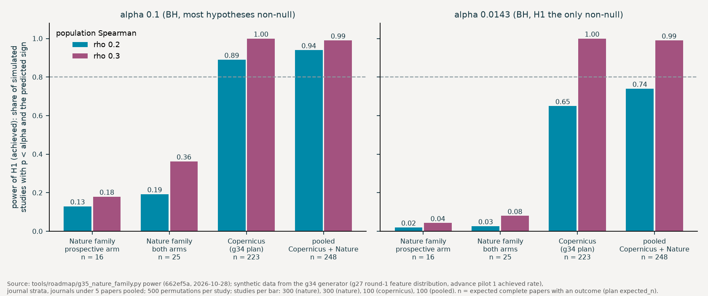

# Nature-family papers: layered reconstruction, descriptive and pooled

Status: frozen 2026-10-28 with `tools/roadmap/g35_nature_family.py freeze` (code commit 662ef5a); machine-readable plan `nature-family.json`.

Machine-readable plan: `nature-family.json` (written by `draft` and `freeze`; the json is authoritative where the two differ). Code: `tools/roadmap/g35_nature_family.py` (`features`, `test`), which calls `tools/roadmap/g34_reconstruction.py` for every shared step. Direction from the PI on October 28, 2026; drafted the same day by a Claude Code workflow agent; the PI freezes.

## Question

- Same question as the reconstruction plan (`reconstruction.md`): is the outcome of a paper associated with the iterations the paper erases, once the loops and steps the paper itself reports are held fixed?
- Here the record of those iterations is a Nature Portfolio peer review file: referee reports, editor letters and the authors' response letters, round by round. There is no open discussion and no discussion preprint.
- No confirmatory claim. The papers are too few (power below). The plan fixes, before the feature layer exists, what is computed and how it is reported, and how the papers join the Copernicus papers in a pooled sensitivity.

## Why a separate plan

- PI decisions of October 28 (`private/data/roadmap/DECISIONS.md`): every draw includes all journals equally; the NC and CEE peer review files are in the review arm; every eligible round-1 and round-2 paper is coded completely.
- The frozen reconstruction plan covers Copernicus papers only. Its review addendum codes disclosures by Copernicus author units (AC, AR). `ERRATA.md` (October 28) promises the cop22 NC and CEE papers their own plan, frozen before any of their advance codings exists, with an advance tag apart from the full run.
- The review record of these papers is read by `tools/roadmap/g27_nature_units.py` (reader 1.2.0) into referee (`R<n>-round<k> ¶m`), editor (`E-round<k> ¶m`) and author (`A-round<k> ¶m`) units. The review request adds `agents/coder/REVIEW_ADDENDUM_NATURE.md` 1.0.0 as a second system block; the validator is `tools/check_coding_nature.py`, which imports the frozen `tools/check_coding.py` unchanged.

## Two arms

- **Prospective arm** (set `nature22`): the 18 NC and CEE papers of the cop22 draw. No advance coding or advance request of any of them exists at freeze; `freeze` refuses otherwise, and `test` refuses any advance attempt not later than the freeze commit. Advance tag `nature22-advance`.
- **Post-hoc arm** (sets `nature_r1`, `nature_r2`): the round-1 and round-2 Nature Portfolio papers with a peer review file. They were coded under the advance full run (tag `full-advance`) before this plan. Their verdicts are on disk and entered the advance test of `advance-plan.json` in aggregate.
- Their review codings do not exist yet. `freeze` refuses when any Nature-family review coding, batch request or attempt of a post-hoc paper exists, or an advance record under a tag other than `full-advance`.
- The review codings give the review-derived features: outside-only loops, tried and dropped, review loops, review V loops, claim narrowed, disclosures kept and dropped. Paper returns, revisits and steps come from the inquiry codings (`calc1`, `r2`), which exist for these papers. The advance test already related them to outcomes in aggregate (`advance-plan.json` H9, any return after failure against score).
- The plan is therefore blind to the association of the review-derived features with outcome for the post-hoc papers. It is not blind to their outcomes, to H8 (paper returns) or to the three covariates (paper steps, returns, revisits). H8 is left out of P1b, P2 and the post-hoc and both-arms estimates; the covariates stay in every model and are labelled not blind for this arm. `freeze` records the sha256 of each post-hoc paper's `full-advance` coding; `test` uses those files only, and a changed or re-coded file is a deviation.
- The post-hoc arm is reported apart and enters the pooled sensitivity only as the labelled variants P1b and P2. The drafting agent listed which advance files exist for these keys and did not read any verdict.
- Alternative not taken: leave the post-hoc papers out of the frozen sample. With 16 expected prospective papers the arm alone carries almost no information (power below); the 9 post-hoc papers add about half again, and their feature layer is still unseen.

## Sample (from `sample()`, October 28, 2026)

- Rule: eligible papers (the set manifest) with a 10.1038 DOI whose review folder holds a peer review file that the reader parses; the advance pilot papers left out, as in the reconstruction plan.
- `nature_r1` (round 1, `derived/calc1/manifest.jsonl`): 14 Nature Portfolio papers; 3 with a peer review file (1 NC, 2 CEE). Without one: 8 Scientific Reports, 1 Nature Geoscience, 2 CEE whose article pages link no file.
- `nature_r2` (round 2, `derived/r2calc/manifest.jsonl`): 22 Nature Portfolio papers; 8 with a peer review file, of which 2 are advance pilot papers (left out); 6 in the sample (2 NC, 2 CEE, 2 Nature). Without a file: 2 Scientific Reports, 3 Nature Climate Change, 4 npj Climate and Atmospheric Science, 2 Nature Geoscience, 1 Nature Ecology & Evolution, 2 NC.
- `nature22` (cop22, `derived/cop22calc/manifest.jsonl`): 18 papers (9 NC, 9 CEE), all with a file; entered in g32's `draw_order`, fixed at freeze. The test takes the longest prefix of that order in which every paper has an inquiry, review and advance attempt, so a budget-limited subset is a prefix, never a choice.
- Peer review files: g32 `prf` (cop22) and `tools/roadmap/g37_nature_review_files.py fetch` (rounds 1 and 2; open downloads linked from the article page). All 27 sample files parse cleanly under reader 1.2.0 (at least one referee unit, one author unit with own text, and at most 15% of author-block lines still in two columns). Reader 1.2.0 rebuilds two-column pages from their word boxes: 16 pages of `g22_W4223465662` (referee comment and reply side by side), 3 of `g22_W4310645206` (one comment and reply table, two data tables in the letter) and 3 of `g22_W4293109378` (a referee's annotated manuscript with margin comments); the largest share of author-block lines left in two columns is 2.2% (`g22_W4213002586`).

## Layers and completeness

- Layers 1 (reported: inquiry coding), 2 (review-induced: review sequence) and 3 (disclosed: disclosures in A units). Layer 4 (revised after submission) needs a discussion preprint; these papers have none, so `revision_share` and H7 are dropped.
- **Complete** means all of:
  - N0: the peer review file parses cleanly.
  - N1: a valid blind inquiry coding (codebook 1.5.0) under `calc1` or `r2` (the file hashed at freeze) or `cop22` (answered by claude-opus-5-5, at most one content re-draw).
  - N2: a valid review coding under tag `nature-review` (`validate_nature`, quote checks under the item rule, `review_source` `nature_review_file`, `nature_addendum_version` 1.0.0), with at least one review step triggered by a referee or the editor; answered by claude-opus-5-5, at most one content re-draw, from a request that recorded the item rule.
  - N3: the sha256 of the peer-review-file document recorded with the request equals the document rebuilt now.
  - N5 (test only): a valid advance coding, verdict not U4; prospective: every attempt after the freeze commit; post-hoc: the file hashed at freeze.

## Features and outcomes

- Features are those of the reconstruction plan, computed by the same functions (`g34.features_of` on `g31_reconstruct.paper()`): outside-only loops, tried and dropped, review loops, review V loops, claim narrowed, paper returns, revisits and steps, disclosures kept and dropped; `response_words` counts the words of the A units.
- The author document of the same-event rule is every A unit of the paper. g31's match of a disclosure to a review step reads Copernicus document names only, so on these papers no disclosure matches a review step; no feature used here depends on that match.
- Outcomes as the reconstruction plan: achieved, score, W3, W count, overreach (advance coding); cnp and fwci from the set's metrics.

## Analysis

- **D, descriptive** (prospective arm, post-hoc arm, both): feature distributions, overall and by journal; verdict distribution; for each hypothesis of the reconstruction family but H7, the partial Spearman within journal strata with a 95% bootstrap interval, reported as an estimate only, with no p-value and no verdict. The post-hoc and both-arms estimates leave out H8.
- **P, pooled sensitivity** with the complete Copernicus papers of the frozen reconstruction test (its own sets, tags, checks and cut-off; not run when its checks refuse). H1-H6 and H8; the reconstruction test rule (partial Spearman, Freedman-Lane permutation within strata, bootstrap, Benjamini-Hochberg q below 0.1).
  - P1: strata journal (each journal its own stratum, journals under 5 papers pooled), prospective arm only; the H1-H2 answer rule applied and labelled "pooled sensitivity".
  - P1b: as P1 with the post-hoc arm added, labelled post-hoc; without H8.
  - P2: strata journal x set, both arms; without H8.
  - None of these changes the frozen reconstruction answer.

## Power

- Expected complete papers with an outcome (`expected_n` in the json): 16.4 prospective (18 papers x the measured inquiry, review and advance validity rates), 8.6 post-hoc (9 papers with a valid inquiry coding and an advance file on disk x the review validity rate of the E3 run, 58 of 61).
- On synthetic data with a true population Spearman of 0.2 for H1, the test finds the predicted sign at alpha 0.1 in 13% of simulated studies for the prospective arm alone and 19% for both arms; at 0.3, 18% and 36%. That is why the arms are descriptive only.
- Adding both arms to the 223 expected Copernicus papers moves the power at 0.2 from 0.89 to 0.94 at alpha 0.1; with 100 simulated studies per bar the Monte Carlo standard error is about 0.03, so the gain is within simulation noise.

## Before the freeze (PI)

- Commit every FROZEN and RECORDED file (`freeze` refuses on uncommitted or untracked ones), including `tools/code_papers.py` with the Nature-family hook.
- Freeze before any review coding of a post-hoc paper is submitted and before any advance coding of a cop22 NC or CEE paper.
- Then commit `nature-family.md`, `nature-family.json` and `nature-family_power.png` together and push.
