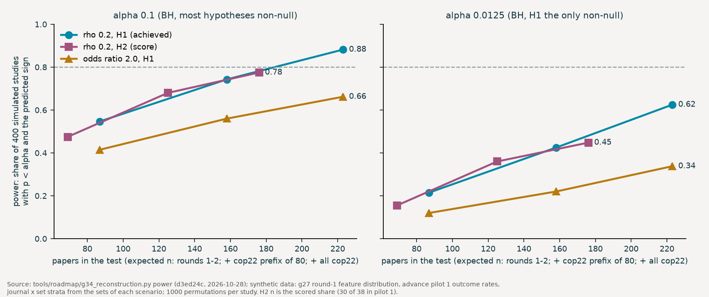

# Reconstruction analysis: do outcomes depend on the iterations papers erase?

Status: frozen 2026-10-28 with `tools/roadmap/g34_reconstruction.py freeze` (code commit d3ed24c); machine-readable plan `reconstruction.json`.

Machine-readable plan: `reconstruction.json` (written by `draft` and `freeze`; the json is authoritative where the two differ). Code: `tools/roadmap/g34_reconstruction.py` (`test`). Descriptive companion: `tools/roadmap/g31_reconstruct.py`. Direction from the PI on October 28, 2026; drafted the same day by a Claude Code workflow agent; frozen by the PI.

## Question

- A paper is the paper's account of the work, not its chronology (Holmes, 1987; Medawar, 1996). It leaves out loops.
- In Copernicus journals part of what it leaves out is on the record: referee comments, author responses and the discussion preprint (Pöschl, 2012).
- Question: is the outcome of a paper associated with the iterations the paper erases, once the loops and steps the paper itself reports are held fixed?
- Outcome here is the blind advance coding (agents/advance/RUBRIC.md v1.1.0): reported warrant judged from the blinded published text only. Citation impact (cnp, fwci from g04) is secondary.

## Why freeze now

- The advance full run (572 papers, `g24_advance.py`) contains 100 non-pilot Copernicus papers with a valid inquiry coding: 63 of round 1 and 37 of round 2. Once one of their advance codings exists, this plan can no longer be frozen blind.
- `freeze` refuses when an advance coding (valid or invalid, collected or rescued) or an advance batch request exists for any Copernicus paper outside the advance pilot keys, and when an advance record has a key with no known DOI.
- It also refuses when a FROZEN or RECORDED file is uncommitted or untracked (`git status --porcelain`), when `METASCIENCE_PRIVATE` is set with the default plan path, and when the quote-check rule of `tools/check_coding.py` differs from the plan's. It builds the whole plan, power included, before it rewrites this file's Status line and writes the json. The json records the code commit, the freeze time and the private tree read.
- On October 28 (checked by running `violations()` on the private tree): 0 such codings and 0 unknown keys. The advance folders and batches hold the 20 pilot keys only.

### What `test` checks before it reads an outcome

- The plan on disk is byte-equal to the last commit touching `preregistration/reconstruction.json`, and that commit has status frozen.
- That commit is on a remote branch (pushed), and the plan's code commit is its ancestor.
- Every FROZEN file equals its version in that commit, unless `--accept-deviation`, which records the list.
- Every advance attempt of a non-pilot paper that enters C5 (state.json batch submission or synchronous attempt) is later than the freeze commit, to the minute, in local time.
- `--plan` is refused unless `METASCIENCE_PRIVATE` points at a synthetic tree. There the git checks are replaced by the plan's own freeze time, and the result says so.

## Sample

| set | drawn by | inquiry coding (layer 1) | review coding with disclosures (layers 2, 3) | advance coding | candidates on disk |
|:--|:--|:--|:--|:--|:--|
| round 1 | equal cnp quintiles of 600 preselected papers | calc1 | calc1-review-v2 (to be coded) | full-run tag of `advance-plan.json` | 61 with an open discussion |
| round 2 | open access only, at most 4 papers per journal | r2 | r2-review-v2 (to be coded) | full-run tag of `advance-plan.json` | 39 Copernicus papers less the pilot paper; 37 with a valid r2 coding, 33 of them with an open discussion |
| cop22 | equal quota per journal, spread over impact quintiles (g32) | cop22 (to be coded) | cop22-review-v2 | cop22-advance | 152 Copernicus papers of the cop22 draw |

- Tags can be renamed at freeze (`--set NAME=INQUIRY,REVIEW,ADVANCE[,ROOT[,ADVANCE_ROOT]]`); after the freeze they are fixed. ROOT `open` reads an open-weight rerun from `private/analysis/codings/open/<tag>` (`tools/code_papers_open.py`), so the OLMo rerun runs the same frozen code.
- The review coding is the defined review task (`tools/code_papers.py --review-dir`, `agents/coder/REVIEW_ADDENDUM.md` 1.0.0). The E3 codings (tag calc1-review) have no disclosures block, so round 1 is coded again. E3 and the E4 labels enter only sensitivity S6.
- The Nature Communications and Communications Earth & Environment papers of the cop22 draw are outside this plan by design. Their peer review files carry no AC or AR author units, and the review addendum codes disclosures by those units. (They would also fail C4: no discussion preprint.)
- **Complete** means all of:
  - C0: open discussion on the Copernicus page, DOI 10.5194;
  - C1: a valid blind inquiry coding (codebook 1.5.0). Rounds 1 and 2 were coded before this plan, so the coding must be the file hashed at freeze. cop22: answered by claude-opus-5-5, at most one content re-draw;
  - C2: a valid review coding under the addendum, with at least one review step by a referee, editor or commenter. Its disclosure quotes are checked against the texts. It must be answered by claude-opus-5-5 (state.json `spent`), with at most one content re-draw, from a request that recorded the quote-check rule `item`;
  - C3: the sha256 of the discussion text and of the author-responses document recorded with the request equal those of the texts on disk;
  - C4: the discussion preprint and the published text found by g26, with at least 80% of the reported steps located in the published text;
  - C5: a valid advance coding (no rescue, as g24 reads the full run) whose verdict is not U4, every attempt submitted after the freeze commit.
- **Quote checks, rule `item`.** A disclosure is dropped and counted (`disclosures_dropped`) when its unit is not an author unit, its quote is in no author unit of the cited document (AC1, AR2), its quote is referee text, or its final quote is not in the published paper. The coding stays valid. On the 58 E3 codings, 705 of 746 review-step quotes sit in the cited unit and 746 of 746 in the same document (rerun October 28). A strict rule would drop whole papers, and more often papers with many disclosures, which truncates the H1 feature.
- **Re-draws.** Review runs and the cop22 inquiry run re-draw a content failure at most once (`code_papers.py retry`, `REVIEW_MAX_REDRAWS`, `--max-redraws 1`); `test` enforces the same cap from state.json.
- **Excluded:** g22_W4205292752 and g22_W4223595027, and every other advance pilot key (`derived/advance/pilot_keys.json`).
- A key in two sets counts in the first. Incomplete papers are counted by layer and reported.
- **cop22 entry order.** g32's `draw_order` (the Copernicus rows of `derived/cop22/preselect.json`), which interleaves journals in proportion, is fixed in the json at freeze. Code the cop22 papers in that order. The test takes the longest prefix in which every paper has an attempt under each of the inquiry, review and advance tags (state.json batch or `spent` record, or a file). A budget-limited subset is then a prefix, not a choice.

### Expected n

Rates are measured and listed with their sources in the json (`expected_n.rates`).

| scenario | expected complete papers |
|:--|--:|
| rounds 1 and 2 | 87 (round 1: 56.5, round 2: 30.6) |
| plus the first 80 cop22 papers | 158 (0.892 complete per drawn paper) |
| plus all 152 cop22 papers | 223 |

- Advance validity is now 39 of 40 (pilot 2, rubric 1.1.0, read without rescue as the test reads it); the earlier draft used pilot 1 with rescued codings (38 of 40).
- The round-2 open-discussion rate is read from `open_review_index_r2.json`: 33 of the 37 papers with a valid r2 coding. The earlier draft borrowed round 1's 61 of 64.
- Under the `item` rule a failed quote check costs an item, not a paper, so it does not enter the expected n.

Cost at measured prices:
- review v2 coding: $0.504 per paper;
- inquiry coding: about $0.30;
- advance coding: about $0.20.

Round 1 and round 2 review coding costs about $50. Each cop22 paper costs about $1.00 for all three codings.

## Layers and features

Features are computed by `g31_reconstruct.paper()`, with the review tag as the disclosure source and no agent labels. Every input is therefore a defined prompt, schema and validator task, and can be rerun with OLMo.

| feature | layer | definition |
|:--|:--|:--|
| outside_only_loops | review-induced and disclosed | distinct events among kept disclosures of kind tried_dropped or added_for_review with final_paper_status absent, or with removed true. Two items are one event in the same document at quote coverage 0.5 (g31 DMATCH), or in different documents at 0.8 (an AR page repeating an AC paragraph) |
| tried_dropped | disclosed | distinct events among tried_dropped disclosures, any final status |
| review_loops | review-induced | review steps by a referee, editor or commenter whose move is not declined |
| review_V_loops | review-induced | review_loops at node V |
| claim_narrowed | disclosed | distinct events among claim_narrowed disclosures |
| revision_share | revised | reported steps absent from the preprint over reported steps located |
| paper_returns, paper_revisits, paper_steps | reported | g31 measures of the final-paper walk; the covariates |
| disclosures_dropped | disclosed | disclosures dropped by the quote checks; an S2 covariate |

- added_for_review with final absent is the defined-task form of the case g31 added after a look at the data (E4 `no_change`: a test asked for, run, and reported only in the response). The open question to the PI about that rule is therefore settled for this plan; S6 keeps g31's version for round 1.

## Outcomes

| outcome | definition (RUBRIC.md v1.1.0, `g24 derived()`, `check_advance.basis_gain()`) | papers |
|:--|:--|:--|
| achieved | verdict achieved 1, else 0. Unassessable U1-U3, U5 count as 0 (S7 leaves them out) | all but U4 |
| score | advance_score 1-5 | achieved or not_demonstrated |
| W3 | W3 of the verdict-basis gain met or not_applicable | assessable |
| W_count | W1-W4 of that gain met, 0-4 | assessable |
| overreach | exceeds_warrant no 0, partly 1, yes 2 | assessable |
| cnp, fwci | set metrics (g04) | secondary family |

## Hypotheses (primary family, H1 and H2 primary)

| id | feature | outcome | predicted | theory |
|:--|:--|:--|:--|:--|
| H1 | outside_only_loops | achieved | + | selection under test: a claim that survived alternatives dropped and tests run only for review is more often warranted as reported. Rival: requests follow weak papers (predicts −) |
| H2 | outside_only_loops | score | + | as H1, on the size of the warranted gain |
| H3 | tried_dropped | achieved | + | the reported route is the survivor of the routes tried |
| H4 | review_V_loops | W3 | + | referees ask for checks of the principal threat; the checks enter the text the blind coder reads |
| H5 | review_loops | W_count | + | work reopened at review adds stated uncertainty, checks and consistency |
| H6 | claim_narrowed | overreach | − | a claim narrowed at review fits its warrant. Rival: narrowing is asked of overreaching papers and stays partial (predicts +) |
| H7 | revision_share | achieved | + | text written after submission answers review and adds visible warrant |
| H8 | paper_returns | achieved | + | reported loops are selected for the argument; whether H8 is weaker than H1 is tested separately (below) |

- **Support.** BH q < 0.1 over H1-H8 with the predicted sign is supported. q < 0.1 with the opposite sign is reversed. Anything else is not supported.
- **Answer to the PI's question,** for reported warrant as the blind coder judges it, in 2022 Copernicus papers with an open discussion, drawn by cnp quintile (round 1), from the open-access preselection (round 2) and by equal quota per journal over impact quintiles (cop22). It rests on H1 and H2 only:
  - "yes, positive" when H1 or H2 is supported and neither is reversed;
  - "yes, negative" (the rival) when H1 or H2 is reversed and neither is supported;
  - "inconsistent" when one is supported and the other reversed;
  - "no association detected" otherwise, qualified "rho of 0.2 or more excluded" when the upper 95% bound of both H1 and H2 is below 0.2.
- S6 is reported beside the answer as sign concordance with H1 and H2, not as a condition. It covers round 1 only (at most 58 papers), uses agent labels, and includes g31's E4 `no_change` rule, which was added after a look at the data.
- A supported H1 does not separate selection under test from undisclosed analytic flexibility (Simmons et al., 2011; Gelman & Loken, 2014). Both predict a cleaner reported result, because the advance coder cannot see what was dropped.
- **Secondary family** (its own BH, q < 0.1): the seven features above against cnp and fwci, 14 tests. The predicted sign is + for all but claim_narrowed (−). The directions are weakly grounded and the family is labelled secondary.
- S13 and S14 (paper_returns against cnp and fwci) replicate a known round-1 null: rho 0.042 and 0.045, q 0.717 and 0.707 on all 374 round-1 papers (g17, `derived/outcomes/outcomes.json`, October 27). Revisits, a covariate here, is already tested in the round-2 confirmatory family (H07, H08).
- **Round 1 is left out of the secondary family.** The g34 dry run of October 28 computed these 14 associations on real round-1 features (E3 codings and g27 labels standing in for the review v2 coding) against real round-1 cnp and fwci, before the freeze. That exclusion is declared here before any of those values was used, whatever they were. The secondary family therefore runs on round 2 and cop22, about 32 to 164 papers. The primary family is unaffected: its outcomes were synthetic in the dry run.
- **H1 against H8.** "H1 stronger than H8" when the one-sided paired-bootstrap p of H1 minus H8 (partial rho, same papers and strata, 500 resamples) is below 0.05. Reported beside the family, not part of the answer. Shared method tilts this contrast toward H8 (see the shared-method section).
- **Reported beside the rule, not tested:** the Mantel-Haenszel odds ratio, within strata, of any outside-only loop against achieved.
- **Decompositions (no verdicts).** H1 mixes two mechanisms:
  - D1: H1 and H2 with tried_dropped absent only (selection among routes);
  - D2: H1 and H2 with added_for_review absent only. An analysis added for review and kept out of the paper cannot add warrant the blind coder sees, so any association here is selection or confounding (for example how conscientious the team is).

## Test

- **Statistic: partial Spearman within strata.**
  - Ranks of the feature, the outcome and the covariates.
  - Feature and outcome ranks are residualized on stratum indicators and on the covariate ranks: paper_steps, paper_returns, paper_revisits, less the feature itself.
  - rho is the correlation of the two residuals.
- **Strata: journal × set.** The three sets were drawn by different designs, so a difference in level between sets inside a journal would otherwise pass into rho. Journals are taken from the DOI (10.5194/<abbr>-). Inside each set, journals with fewer than 5 papers in a test are pooled into one stratum of that set. Round 1 has 33 Cryosphere papers of 61, so with all its candidates it splits into The Cryosphere, Geoscientific Model Development (5) and one pooled stratum; round 2 has no journal with 5 papers and is one stratum.
- **p:** two-sided Freedman-Lane permutation, the outcome residual permuted within stratum, 5000 permutations.
- **Interval:** 95% bootstrap of papers within stratum, 2000 resamples. The generator is `g20.gen('recon|<id>')`.
- **Testable:** the outcome varies, and at least 10 papers lie above the feature's minimum and 10 below its maximum. Otherwise p = 1, kept in the family.

## Power

- Simulated with the planned test (`g34_reconstruction.py power`, 400 synthetic studies per point, 1000 permutations each, seed 2034; rerun October 28). Inputs:
  - the round-1 distribution of the H1 feature in the g27 labels;
  - the achieved rate (24 of 38) and the score distribution of advance pilot 1;
  - journal × set strata from the sets of each scenario (rounds 1 and 2 only for the first row).
- rho = 0.2 is the population Spearman correlation between the observed feature and outcome.
- The odds ratio I consider plausible is 2.0, achieved at about 56% without an outside-only loop against 72% with one. Smaller effects (1.5) are not detectable at these n (power 0.23 to 0.38 at alpha 0.1).
- Power at alpha 0.1 holds when most of the family is non-null; power at alpha 0.0125 holds when H1 is the only non-null hypothesis (BH rank 1). The truth lies between.

| scenario | n | rho 0.2, H1 | odds ratio 2.0, H1 | rho 0.2, H2 |
|:--|--:|:--|:--|:--|
| rounds 1 and 2 | 87 (H2: 69) | 0.55 / 0.22 | 0.42 / 0.12 | 0.48 / 0.16 |
| plus cop22 prefix of 80 | 158 (125) | 0.74 / 0.43 | 0.56 / 0.22 | 0.68 / 0.36 |
| plus all cop22 | 223 (176) | 0.88 / 0.63 | 0.66 / 0.34 | 0.78 / 0.45 |

Each cell gives power at alpha 0.1 / alpha 0.0125.

- Rounds 1 and 2 alone are underpowered for the primary question. The plan becomes informative at rho 0.2 only with cop22.

## Sensitivity (reported, no verdicts)

- **S1:** no covariates.
- **S2:** adds log paper words, log response words (AC paragraphs plus AR document), log author count, log reference count (set metrics) and disclosures_dropped.
- **S3:** strata journal only, pooled across sets.
- **S4:** H1, H2 with items flagged loop true only.
- **S5:** H4 with added_for_review V items present or partly present in the paper.
- **S6:** H1, H2 on round 1 with g31's default outside-only count, from E4 visibility labels and g27 disclosures. These are agent labels and cannot be rerun with OLMo.
- **S7:** H1, H3, H7, H8 with unassessable papers (U1-U3, U5) left out instead of counted as not achieved. Unassessable verdicts plausibly differ by journal type, for example data papers (ESSD) and model papers (GMD).

## Shared-method risk

- The review coding and the advance coding come from the same model family, claude-opus-5-5, reading text of the same paper.
- The advance coder reads only the blinded published text and never the review record. The review coder reads the review record and the published paper.
- Shared method can bias H1 in either direction:
  - a terse paper makes more disclosures absent and shows less reported warrant, which pushes H1 negative;
  - a long paper with long responses yields more disclosures and more reported warrant, which pushes H1 positive.
- S2 holds paper and response length fixed.
- The risk is not equal across features. H7, H8 and the covariates come from the same published text that the advance outcome is read from, by the same model family. The H1 feature comes from the review record. H8 therefore carries more shared-method variance than H1, which tilts the H1 minus H8 contrast toward H8.
- The OLMo rerun of both tasks on the same papers (`tools/code_papers_open.py`, hand-off tasks `review` and `inquiry-cop22` in `g33_handoff.py`) is the cross-model check. Freeze those hand-offs before the review-v2 and cop22 runs.

## Gates

- **Advance:** g24 `gate()` on the advance codings of the full-run tag, which holds the 40 human-rated gold papers (14 of them round-1 open-review Copernicus papers). Until it passes, outcomes are reported as the model's judgment of reported warrant.
- **Disclosures, agreement:** g30 on round 2 (tag r2-review-v2), restricted to tried_dropped and added_for_review (`g30_disclosure_agreement.py --tag r2-review-v2 --kinds tried_dropped,added_for_review --out disclosure_agreement_r2_oo`), against g27 labels of round 2. It passes at final-status alpha (nominal) ≥ 0.667 and detection precision ≥ 0.6. Round 2 because the instrument was developed on round 1. Round 2 has no g27 labels yet.
  - g27 is one agent labeller of the same model family, not a reference standard. It also never saw sentences the authors copied into the paper.
- **Disclosures, absent status:** the validator checks final quotes only for present and partly, so an `absent` answer cannot be checked by text matching. On the round-1 g27 labels, coverage of the disclosure content in the published text does not separate the statuses (absent: 38 items, median 0.14; present: 66 items, median 0.26). A human audit therefore checks it:
  - 50 disclosures of kind tried_dropped or added_for_review with status absent, drawn at random from the kept disclosures of the complete papers (C0-C4), stratified by set in proportion (`g34_reconstruction.py audit-sample`, seed 2034);
  - raters search the published XML text for the content and record yes or no in `derived/reconstruction/absent_audit_form.csv`, then `absent_audit.json`;
  - the gate passes when at least 80% are confirmed absent.
- Until both disclosure gates pass, outside-only features are labelled unvalidated model coding.
- Disclosure `node` and `loop` have no check; only S4 uses `loop`.

## Open before freeze (PI)

- Which cop22 draw stands. Two draw designs exist; the json records the manifest and preselect sha256 at freeze.
- AR document in the review call (default on). This plan assumes it is on.
- Quote checks: this plan uses the per-item rule (`item`). Switching to `strict` means changing `DISCLOSURE_CHECKS` in both `check_coding.py` and g34, and lowering the expected n.
- Who rates the absent-status audit (50 items), and g27 labels for round 2 (needed by the disclosure-agreement gate).
- Tag names, if different from the defaults above.
- Budget. Spent $229.64, plus pilot 2 (about $6) and leak probes (about $5); the advance full run is $89 to $132. That leaves about $127 to $170 under the $500 cap. Review coding of rounds 1 and 2 takes about $50 of it, so roughly 75 to 120 cop22 papers fit, coded in draw order.

## Files hashed at freeze

- Frozen: g34, g31, g26, check_coding, REVIEW_ADDENDUM.md, review_addendum.schema.json, CODEBOOK.md, coding.schema.json. `test` compares each with its version in the freeze commit and refuses if any changed, unless `--accept-deviation`, which records the list.
- Recorded only (reported when changed since the freeze commit): code_papers, code_papers_open, check_advance, RUBRIC.md, advance.schema.json, g24, g17, g20, g27, g30, g33, rounds, common.
- Every one of them must be committed before `freeze` runs.

## References

- Gelman, A., & Loken, E. (2014). The statistical crisis in science. *American Scientist, 102*(6), 460. https://doi.org/10.1511/2014.111.460
- Holmes, F. L. (1987). Scientific writing and scientific discovery. *Isis, 78*(2), 220–235. https://doi.org/10.1086/354391
- Medawar, P. (1996). Is the scientific paper a fraud? In *The strange case of the spotted mice and other classic essays on science* (pp. 33–39). Oxford University Press. https://doi.org/10.1093/oso/9780192861931.003.0003
- Pöschl, U. (2012). Multi-stage open peer review: Scientific evaluation integrating the strengths of traditional peer review with the virtues of transparency and self-regulation. *Frontiers in Computational Neuroscience, 6*, 33. https://doi.org/10.3389/fncom.2012.00033
- Simmons, J. P., Nelson, L. D., & Simonsohn, U. (2011). False-positive psychology: Undisclosed flexibility in data collection and analysis allows presenting anything as significant. *Psychological Science, 22*(11), 1359–1366. https://doi.org/10.1177/0956797611417632
