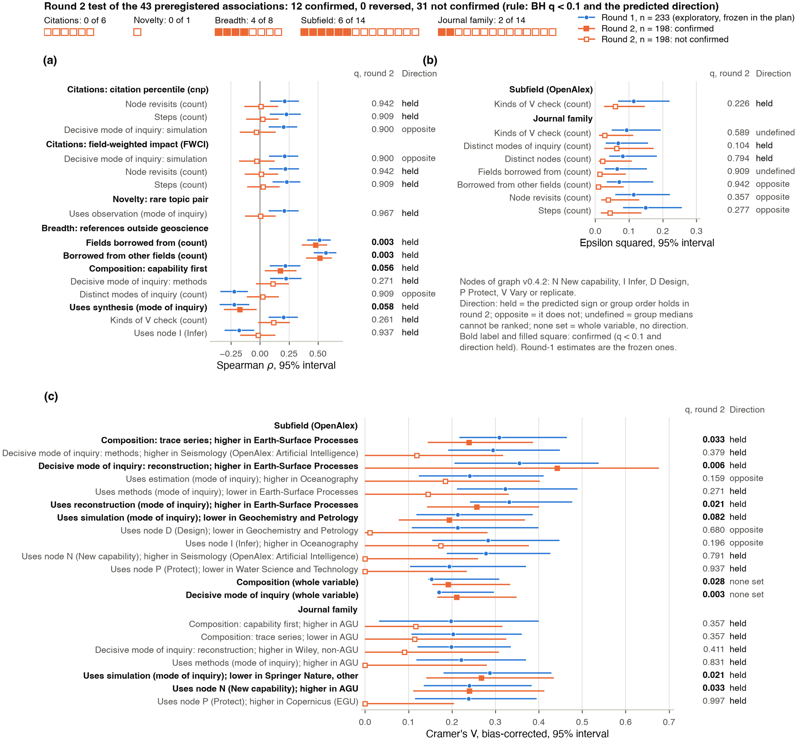

# Topics and journals {.unnumbered}

[Drafted]{.status .drafted} [v0.3 · October 27, 2026 · round 1, 374 coded papers (exploratory) · round 2, 198 coded papers (confirmatory test of 28 field and venue associations) · paper codebook 1.5.0 · model-coded, no human check yet]{.status-line}

- **Question.** Which fields and journals are in the coded corpus? Does reaching full text and a coding depend on field or venue? Do workflows and outcomes differ by field and venue, do those differences hold in a second sample, and do the [workflow-outcome associations](workflow-outcomes.qmd) hold once field or venue is held fixed?
- **Short answer.** Field differences replicate more often than venue differences (6 of 14 against 2 of 14). Of 28 field and venue associations frozen from the first round-1 analysis (233 papers), round 2 (198 papers) confirmed 6 of 14 by subfield and 2 of 14 by journal family. That the composition varies by subfield recurs in round 2 under any grouping; the decisive mode of inquiry does so only under the frozen round-1 groups (H41, H42; these tests carry no direction). Of 12 directional subfield contrasts, 4 passed: 3 for reconstruction in Earth-Surface Processes, all resting on the same 3 round-2 papers, and 1 (simulation in Geochemistry and Petrology) by sign only. Walk length differs by journal family in round 1 only. In round 1, journal family predicts which papers get coded far more strongly than subfield does (Cramér's V, an association strength from 0 to 1, 0.76 against 0.36), through full-text access.
- **For geoscientists.** Round 1 over-represents the convenor's own topics, cryosphere above all (19% of coded round-1 papers against 4% of the 2022 pool), and under-represents seismology journals without a full-text route (2 of 46 eligible Seismological Society of America papers coded, 6 of 34 Oxford University Press papers). Round 2, at most 4 papers per journal, is spread over 114 journals. Papers in Earth-Surface Processes (OpenAlex; here mostly stratigraphy, dated deposits and palaeoenvironment) rest on reconstruction from traces in both rounds, though round 2 has only 3 of them, and agreement between a palaeoenvironment topic label and a reconstruction coding checks the coder more than it describes the field. Two OpenAlex subfield names mislead: "Artificial Intelligence" here holds only seismology papers, and "Atmospheric Science" is mostly cryosphere.
- **For NLP researchers.** Corpus composition is set by the sampling design and by licensing and retrieval together. The round-1 venue differences were not confirmed after a change of journal mix; round 2 cannot tell selection, population and venue apart, but a corpus concentrated in a few journals can produce patterns that look general and are not. Any model of research workflows trained or evaluated on such a corpus inherits its topic and venue skew.
- **Scope.** Results on this page are aggregates by field, topic and journal. Codings with quotes, derived tables and figure provenance are public in the data release, [`data/roadmap-release/`](https://github.com/Denolle-Lab/metascience-and-AI/tree/framework-v0.5/data/roadmap-release). The confirmatory plan is public: [`preregistration/round2-confirmatory.md`](https://github.com/Denolle-Lab/metascience-and-AI/blob/framework-v0.5/preregistration/round2-confirmatory.md). Paper texts, abstracts and review texts are not redistributed. Per-paper records of the papers in human coding are held back until that coding is done.

## Measures

Full definitions of rounds, the workflow features (node, mode of inquiry, steps, revisits, decisive mode of inquiry), valid coding, Spearman rho, bootstrap intervals, BH q and the verdicts confirmed, reversed and not confirmed are on [workflows and outcomes](workflow-outcomes.qmd#measures). The outcome metrics, in brief (all from OpenAlex, retrieved October 2026, about four years after publication):

- **cnp (impact).** Citation-normalized percentile: the paper's citation count ranked among works of the same OpenAlex subfield, year and type, 0 to 1.
- **FWCI (impact).** Field-weighted citation impact: citations divided by the mean for those works; 1 is the world average. cnp and FWCI correlate at 0.99, so they are one impact signal.
- **novelty_pair (novelty).** −log10(1 + number of 2017 to 2021 works whose two leading OpenAlex topics are the same pair as the paper's); higher means a rarer pair.
- **breadth_refs (breadth).** Share of the paper's classified references that lie outside geoscience.
- **Advance.** A blind human rating of the contribution; not yet measured, so not used here.

novelty_pair and breadth_refs are not normalized by subfield, so part of any difference between subfields is field structure.

Terms used only here:

- **OpenAlex topic, subfield, field.** OpenAlex assigns each paper a leading topic by a classifier over title, abstract, venue and citations; topics nest in subfields and fields (for example, the topic Seismic Imaging and Inversion Techniques sits in the subfield Geophysics, which sits in the field Earth and Planetary Sciences). These are machine labels, not author keywords. OpenAlex files topics, not papers, under subfields, so a subfield can hold topics from another discipline.
- **Ring.** Round 1 drew half its papers from the core ring, the convenor's own 8 OpenAlex topics (seismology, seismic waves and imaging, earthquakes and tectonics, seismic sensors, cryosphere, high-pressure geophysics), and half from the broad ring, 8 Earth-science subfields. The convenor is the study's principal investigator. Round 2 drew per ring from the rest of the pool, open access only, at most 4 papers per journal.
- **Journal family.** Publisher group from DOI prefix, then publisher, then journal name. AGU (American Geophysical Union, the largest US geoscience society) is its own family although Wiley publishes its journals. Copernicus (mostly EGU): journals with DOI prefix 10.5194, nearly all of the European Geosciences Union, plus European Journal of Mineralogy and Scientific Drilling. SSA: Seismological Society of America (Bulletin of the Seismological Society of America, Seismological Research Letters). Oxford: Oxford University Press, here Geophysical Journal International, published for the Royal Astronomical Society. Springer Nature (other) includes English translations of Russian-language journals distributed by Springer (Pleiades, Allerton), which are paywalled and have no text-and-data-mining route.
- **Effective number of journals.** 1/HHI, where the Herfindahl index HHI is the sum of squared journal shares: the number of equal-sized journals with the same concentration.
- **Cramér's V.** Strength of association between two categorical variables, 0 (independent) to 1 (one determines the other); bias-corrected [@bergsma2013]. Unrelated to node V. Its 95% interval is a percentile interval of the resampled V, which is biased upward under resampling, so read the interval as spread; it can sit above its own estimate.
- **Rate difference.** Share of papers with a property in one category minus the share in all other categories.
- **Kruskal-Wallis epsilon squared.** Kruskal-Wallis H [@kruskal1952], a rank-based one-way analysis of variance, divided by n − 1: the share of rank variance in a count or outcome explained by the grouping, 0 to 1.
- **Within-stratum rank correlation.** Spearman correlation computed after centring both ranks within each subfield (or family, or subfield × family); only co-variation inside a stratum counts. Its p comes from shuffling outcomes within strata.
- **Holds within strata ("survives").** Same sign as the original correlation and BH q < 0.1 over the 114 stratified tests (38 associations × 3 stratifications). Reported with the stricter count of those whose bootstrap interval also excludes 0.
- **Leading group and predicted direction.** For a binary feature in the round-2 test, the leading group is the round-1 group with the largest rate difference from the rest; the prediction is that its round-2 rate difference has the same sign. For a count, the prediction is that round-2 group medians rank the groups in the round-1 order (Spearman correlation of the medians above 0). A whole categorical variable (all levels of composition, or of the decisive mode of inquiry) carries no direction.
- **Test families.** BH q is computed separately for each block: coverage tests (12 per round and 12 pooled), workflow tests (116 in round 1, 106 in round 2, 130 pooled with round as a stratum; each feature tested once against subfield and once against journal family), outcome tests (16 per block), the 114 stratified tests, and the 43 confirmatory tests, of which 28 are on this page.

## Who is in the corpus

{fig-alt="Stacked bars of subfield and journal-family shares by stage for both rounds; dot plots of journal shares and of round-1 coverage differences by family: Copernicus and Nature portfolio fully coded, AGU 97%, Wiley (non-AGU) 97%, Elsevier 95%, Springer Nature (other) 40%, Oxford 18%, SSA 4%."}

- **Concentration.** Effective number of journals in round 1: 68 in the pool, 51 preselected, 44 eligible, 40 with full text, 40 coded. Round 2: 111 drawn, 83 coded (114 distinct journals). Both rounds together: 63 among 572 coded papers.
- **Cryosphere: design, then access.** The topic "Cryospheric studies and observations" is 3.9% of the pool. The design raises it to 13.5% of the round-1 preselection, because it is one of the 8 core-ring topics. Access raises it further: 14.9% of eligible, 19% of full-text and 19.3% of coded round-1 papers. The Cryosphere, an open-access EGU journal that is fully coded, holds 33 of the 374 coded round-1 papers and 35 across both rounds.
- **"Artificial Intelligence" is seismology.** This OpenAlex subfield is 0.8% of the pool and 11% of the round-1 preselection (64 papers). All have the leading topic "Seismology and Earthquake Studies", one of the convenor's core-ring topics, which OpenAlex files under Computer Science. 24 of its 61 eligible round-1 papers are coded, and 1 round-2 paper. Of the 25 coded, 20 use machine-learning terms somewhere in their coding and 11 in a new-capability step: they are seismology papers, many of them machine-learning seismology.
- **Other subfield names.** "Atmospheric Science" holds 81 of its 125 preselected papers under the cryosphere topic, and 98 of its 171 coded papers across both rounds (57%). "Ocean Engineering" is the seismic-sensor topic "Geophysics and Sensor Technology" (19 of 19). "Space and Planetary Science" is an archaeology topic (4 of 4, none eligible). "Water Science and Technology" is mostly watershed hydrology (20 of 26 coded). The full topic-to-subfield table is in the data release (`data/roadmap/derived/topics/TOPICS.md`, section 6).
- **Round 1 coverage follows access.** Among eligible round-1 papers, journal family predicts reaching a coding strongly (Cramér's V 0.76), subfield less (0.36). Among papers that already have full text, family no longer predicts coding (0.03, q 0.43); subfield does weakly (0.23, q 0.010), because the seismology group has 24 of 27 full-text papers coded against 374 of 379 overall. The gap is SSA (2 of 46 coded), Oxford (6 of 34) and the translated Russian-language journals in Springer Nature (other) (44 of 110 coded in that family). After the October 27 top-up, AGU (95 of 98 coded, 25% of coded papers) and Elsevier (70 of 74, 19%) are close to their pool shares (23.5% and 22.5%).
- **Round 2 composition.** 198 coded papers: Geophysics 94, Atmospheric Science 62, Oceanography 20, Water Science and Technology 9, Geochemistry and Petrology 8, Earth-Surface Processes 3, Geology 1, the seismology group 1. By family: Springer Nature (other) 50, Copernicus 38, AGU 29, Elsevier 29, Wiley (non-AGU) 22, Nature portfolio 22, others 8. Coverage is independent of subfield (V 0.0, q 1.0) and tied to family (V 0.45) through small venues without full text, mainly SSA and Science Advances.

## Workflows and outcomes by field and venue {#workflows-and-outcomes-by-field-and-venue-round-1-exploratory}

![Node use and decisive mode of inquiry by subfield (a) and steps, revisits and citation outcomes by journal family (b), both rounds with round as a stratum (572 papers; q and Cramér's V from the round-stratified tests). The 38 workflow-outcome associations with q < 0.1 on the 374 round-1 papers (black) recomputed within subfield, within journal family and within both: citation and novelty outcomes (c), breadth outcomes (d). Squares mark the 15 that the frozen plan tested on round 2 (filled: confirmed).](assets/roadmap/fig12_field_workflows.png){fig-alt="Heat map of node and decisive mode-of-inquiry shares by subfield; interval plots of medians by journal family; two interval plots of correlations with four estimates per association, 24 of 38 surviving every stratification, with round-2 verdict squares on 15 rows, 4 filled."}

- **How many differences.** Round 1: 56 of 116 workflow tests pass q < 0.1. Round 2 alone: 4 of 106, partly because its subfield groups are small (Earth-Surface Processes 3, Geochemistry and Petrology 8, Water Science and Technology 9, the seismology group 1; these are pooled). The confirmatory test does not pool: it keeps the round-1 groups, so Earth-Surface Processes enters with 3 papers and the seismology group with 1. Both rounds with round as a stratum: 45 of 130.
- **Workflow differs by subfield.** Papers in the seismology group that OpenAlex calls Artificial Intelligence are decided by a method in 67% of cases (16 of 24; 46 points above the rest), 88% build a new capability (node N), and they perform the most kinds of check (median 4 against 3). Papers in Earth-Surface Processes (OpenAlex; mostly geological-formation, coastal and aeolian topics) are decided by reconstruction, inferring a past event from its traces, in 38% of cases (30 points above the rest), and the trace-series composition fits 59% (34 points above). Water Science and Technology papers rarely protect a hypothesis (node P in 6%, 28 points below).
- **Walk length differs by venue in round 1.** Median steps: Copernicus 24, AGU 23, Nature portfolio 22.5, Elsevier and Springer Nature (other) 22, Wiley (non-AGU) 19 (epsilon squared 0.089). Revisits follow (0.071). Copernicus papers use protect in 52%, 23.5 points above the rest (24.3 at the first analysis); Springer Nature (other) papers use simulation as a mode of inquiry 29 points less often; Elsevier papers fit the trace-series composition 28 points more often.
- **Citations differ by venue, not by subfield.** Median cnp among coded round-1 papers: AGU 0.65, Copernicus 0.65, Wiley (non-AGU) 0.40 (epsilon squared 0.087, q 0.0003); by subfield, 0.029 (q 0.24).
- **Both rounds, round as a stratum (panels a and b).** Median steps: Copernicus 24, Nature portfolio 23, AGU, Elsevier and Springer Nature (other) 22, Wiley (non-AGU) 20 (epsilon squared 0.058, q 0.0015); revisits 0.044. Median cnp: Nature portfolio 0.71, AGU 0.62, Copernicus 0.60, Wiley (non-AGU) 0.44 (epsilon squared 0.062, q 0.0003); by subfield 0.026 (q 0.067). Venue still separates citation more than field does once round 2 is added.
- **The AGU selection of the first analysis is gone.** At the first analysis the 16 coded AGU papers were the open-access ones whose PDF existed on October 25. After the top-up, 95 of 98 eligible AGU papers are coded, 67 of them open access, with median cnp 0.65.
- **Novelty and breadth differ by subfield** (epsilon squared 0.10 and 0.14). The seismology group cites outside geoscience most (median 0.24 against 0.03 overall). Neither measure is normalized by subfield, so part of this is field structure.
- **Entry state** does not differ by family (q 0.34). It differs by subfield (V 0.14, q 0.013), driven by the 6 pooled Ocean Engineering papers, 5 of which enter on a capability.

## Round 2: what replicated {#round-2-what-replicated}

- **Test.** The 28 field and venue associations with q < 0.1 at the first analysis (233 papers) are H16 to H43 of the [frozen plan](https://github.com/Denolle-Lab/metascience-and-AI/blob/framework-v0.5/preregistration/round2-confirmatory.md) (public commit b4369fe), tested once on round 2 together with the 15 workflow-outcome associations as one family of 43 ([confirmatory test](workflow-outcomes.qmd#confirmatory-test)). Groups are the round-1 groups; a round-2 paper in any other subfield or family goes to "pooled small groups".
- **Verdict.** Subfield: 6 of 14 confirmed. Journal family: 2 of 14. None reversed; among the 20 field and venue rows not confirmed, 6 changed sign without reaching q < 0.1, 2 count rows have an undefined direction and 2 rest on a single round-2 paper. The 6 subfield confirmations are 2 whole-variable associations with no direction, 3 rows on the same 3 round-2 papers and 1 by sign only.

{fig-alt="Interval plots pairing round-1 and round-2 effect sizes. Subfield rows for reconstruction in Earth-Surface Processes and the whole decisive mode of inquiry and composition variables hold; most journal-family rows fall to about zero."}

- **Confirmed, subfield (6).**
  - The decisive mode of inquiry as a whole (H42; bias-corrected V 0.17 at 233 papers, 0.21 in round 2; q 0.003) and the composition as a whole (H41; 0.15, then 0.19; q 0.028). These tests carry no direction, so they do not show that the same subfields carry the same modes of inquiry. H42 is confirmed under the frozen round-1 groups; with round-2 groups of fewer than 10 papers pooled (round 2 alone) the decisive mode of inquiry does not differ by subfield (V 0.10, q 0.54), so this confirmation rests largely on the 3 Earth-Surface Processes and 1 seismology papers. Composition holds either way (q 0.028).
  - Earth-Surface Processes above the rest in reconstruction as a mode of inquiry (H35, q 0.022), reconstruction as the decisive mode of inquiry (H32, q 0.006) and the trace-series composition (H30, q 0.033). These three rest on the same 3 round-2 papers, all coded with reconstruction as decisive and with trace series: a radiocarbon study of rhizoliths in dunes (Acta Geochimica, topic Aeolian processes), an ammonite biostratigraphy of drowning phases in the Alpstein (Swiss Journal of Geosciences, topic Geological formations and processes) and a cave palynology and palaeoenvironment study (Journal of Cave and Karst Studies, topic Karst Systems and Hydrogeology). Reconstruction is the topic of these papers, so the agreement checks the coder; it is not a field result. The exact 95% interval for a rate of 3 of 3 is [0.29, 1.00].
  - Geochemistry and Petrology below the rest in simulation as a mode of inquiry (H36, q 0.082). It passes on the association across all subfields (V 0.19); its own rate difference is −0.005 [−0.39, 0.39] on 8 papers, so its direction holds by sign only.
- **Confirmed, journal family (2).** Simulation as a mode of inquiry is less common in Springer Nature (other) (H20; 50 round-2 papers, rate 0.38, 17 points below the rest, q 0.021). The new-capability node is more common in AGU journals (H21; 29 papers, rate 0.72, 20 points above, q 0.033). A confirmed family row is a contrast between journal sets, not between publishers. Springer Nature (other) is led in round 1 (233 papers) by Earth, Planets and Space (13), and in round 2 by open-access titles such as Swiss Journal of Geosciences, Geoscience Letters, Earth, Planets and Space and Terrestrial, Atmospheric and Oceanic Sciences (4 each), then Journal of Seismology and Physics and Chemistry of Minerals; the mineralogy and petrology titles may carry a subfield effect. AGU is 16 open-access papers in round 1 (JGR Earth Surface and JGR Solid Earth 3 each) and 29 in round 2 (JGR Atmospheres, Earth's Future, Earth and Space Science and G-Cubed, 4 each).
- **Not confirmed, subfield (8).** Methods as decisive and node N in the seismology group (1 round-2 paper, so untestable); estimation and node I in Oceanography (opposite sign, 20 papers; under the frozen rule a reversal needs q < 0.1 on the whole-variable test, so H38 is not reversed, although Oceanography's round-2 difference for node I has the opposite sign with an interval excluding 0, −0.23 [−0.46, −0.00]); node D in Geochemistry and Petrology (opposite sign); methods as a mode of inquiry lower in Earth-Surface Processes (q 0.27); node P in Water Science and Technology (q 0.94); kinds of V check by subfield (q 0.23).
- **Not confirmed, journal family (12).** All seven counts, among them steps (H29), where the round-2 medians rank the families slightly against the round-1 order (Spearman correlation of medians −0.11), and revisits (−0.22). Protect in Copernicus (H22): 34%, 2 points above the rest, against 24 points in round 1. Capability first and trace series in AGU, decisive reconstruction in Wiley (non-AGU), methods as a mode of inquiry in AGU.
- **Reading.** Composition differs by subfield in both rounds; the decisive mode of inquiry does so only under the frozen grouping, and neither test shows which subfields carry which modes of inquiry. The family differences in length, revisits and protect were not confirmed. They are consistent with the round-1 journal mix (The Cryosphere 33 papers, Geophysical Research Letters 25) rather than publishers, and also with low round-2 power; recomputing the round-1 family rows without The Cryosphere and GRL (exploratory, not run) would test the first reading. Round 2 is a different population (open access only, at most 4 per journal, drawn by publisher rather than subfield rotation), and the plan's groups come from 233 papers with 16 AGU and 9 Elsevier papers, so Elsevier is pooled. The seismology contrast is untested.
- **For NLP researchers.** A field association that recurs in a second sample suggests the coder responds to paper content rather than filling a fixed template. It does not show that the codings are correct: the OpenAlex classifier and the coder respond to the same title, abstract and method vocabulary, and a field prior of the coder would recur in any sample; both rounds used the same coder. An ablation that codes a subset from title and abstract only would show how much of the field pattern needs the full text.

## Confounding check

- **Design.** The 38 workflow-outcome associations with q < 0.1 among the 274 tests on the 374 round-1 papers, recomputed within subfield, within journal family and within subfield × family on the same papers. 15 of them are the associations of the first analysis (233 papers) that the frozen plan tested on round 2; the other 23 reached q < 0.1 only at 374 papers and have no out-of-sample test.
- **Survivors.** Within subfield 31 of 38 (25 with an interval excluding 0), within family 36 of 38 (35), within subfield × family 24 of 38 (21).
- **What falls out.** Within subfield, 7 rows, all breadth or novelty: items borrowed from other fields and fields borrowed from, each with novelty_pair; node N (new capability) and an entry on a new capability, each with breadth_refs; claim gate yes, decisive methods and steps, each with breadth_citers (97 papers with at least 10 citers). Within family, 2 rows: distinct modes of inquiry with cnp and with fwci (0.13 and 0.14 overall, 0.08 and 0.09 within family). Within subfield × family, those 9 and 5 more: decisive estimation, node H and distinct modes of inquiry with breadth_refs, reconstruction as a mode of inquiry with novelty_pair, revisits with breadth_citers.
- **The 15 frozen rows.** 15 survive within subfield, 15 within family and 14 within subfield × family (all but distinct modes of inquiry with breadth_refs). Holding up within strata did not predict round 2: of the 14 that survive all three, 4 were confirmed, all with breadth_refs.
- **Citation links shrink within family, not within subfield.** Steps with cnp: 0.174 overall, 0.175 within subfield, 0.109 [0.007, 0.212] within family; revisits with cnp: 0.17, 0.17, 0.11. Copernicus and AGU papers are both longer and more cited. Decisive simulation keeps 0.12 to 0.14 and novelty claims 0.14 to 0.16 in every stratification. Recomputing ranks inside each family instead of centring pooled ranks gives 0.115 [−0.002, 0.233] for steps with cnp.
- **Round 2 does not settle it.** None of the six citation associations was confirmed, and round 2 cannot tell selection, population and venue apart; steps with cnp is 0.02 overall and −0.01 within family in round 2.
- **Breadth links hold.** Items borrowed from other fields stay at 0.51 to 0.54 with references outside geoscience within every round-1 stratification and 0.50 to 0.52 within subfield and within family in round 2; fields borrowed from at 0.45 to 0.49 in round 2. These two are a convergent validity check of the coder (the same thing measured from the text and from the reference list), not workflow-outcome findings.

## Caveats

- Topic, subfield and field are OpenAlex machine labels. cnp and FWCI are normalized within the OpenAlex subfield, so seismology papers filed under Artificial Intelligence are ranked against AI works and cryosphere papers against atmospheric-science works.
- Groups with fewer than 10 coded papers are pooled: in round 1 Ocean Engineering (6) among subfields and AAAS, Oxford, SSA and other (10 together) among families. Several round-1 groups hold 1 to 9 papers in round 2, so the confirmatory test has little power for them, and three confirmed subfield rows rest on 3 papers.
- The direction rule for a binary feature is a test over all groups plus the sign of the round-1 leading group's difference, so a row can pass on the overall association with a negligible leading-group difference (H36), and cannot be reversed without the overall test passing, even when the leading group reverses with an interval excluding 0 (H38).
- The strata of the confounding check are small (9 subfield groups, several with 17 to 29 papers), so it has little power to detect confounding by subfield. The six breadth_citers rows rest on 97 papers. Holding subfield and family fixed does not hold fixed open access, team size or topic within subfield.
- Round 1 is 82% open access and round 2 entirely, so the two rounds differ in population as well as in sample.
- One model coder; citations at about four years.

## Reproduce

- `tools/roadmap/g20_topics_journals.py` (this repository; numpy only, OpenAlex through a cached client) for composition, coverage, workflows by group (round 1, round 2, pooled) and the confounding check; `tools/roadmap/g23_confirmatory.py test` for the round-2 test, run once by design. Figures `tools/roadmap/figures/fig11_topics_journals.py`, `fig12_field_workflows.py`, `fig14_confirmatory.py`. Inputs and results: [`data/roadmap-release/`](https://github.com/Denolle-Lab/metascience-and-AI/tree/framework-v0.5/data/roadmap-release), `data/roadmap/derived/topics/`, `data/roadmap/derived/confirmatory/`.
