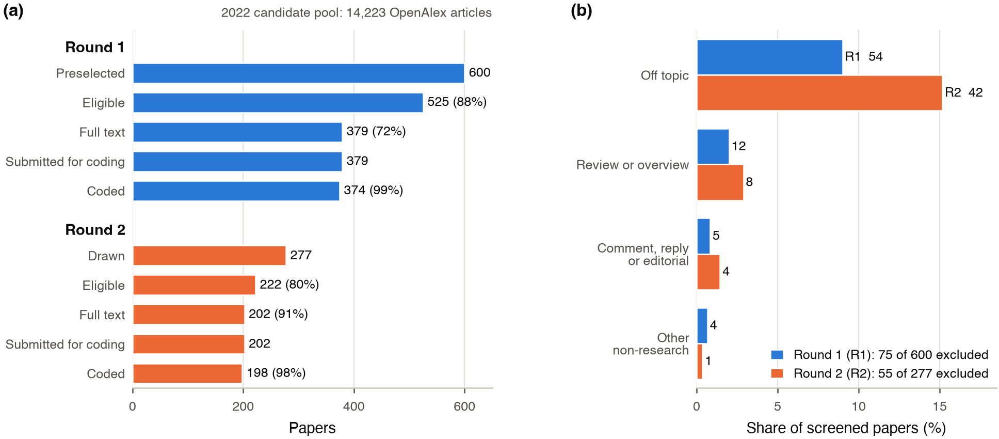
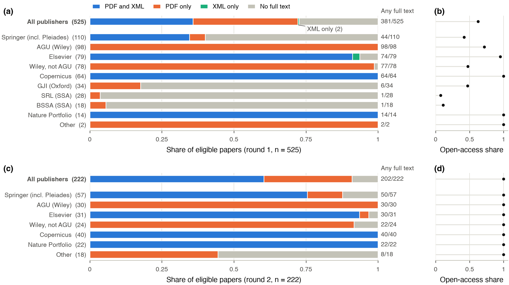
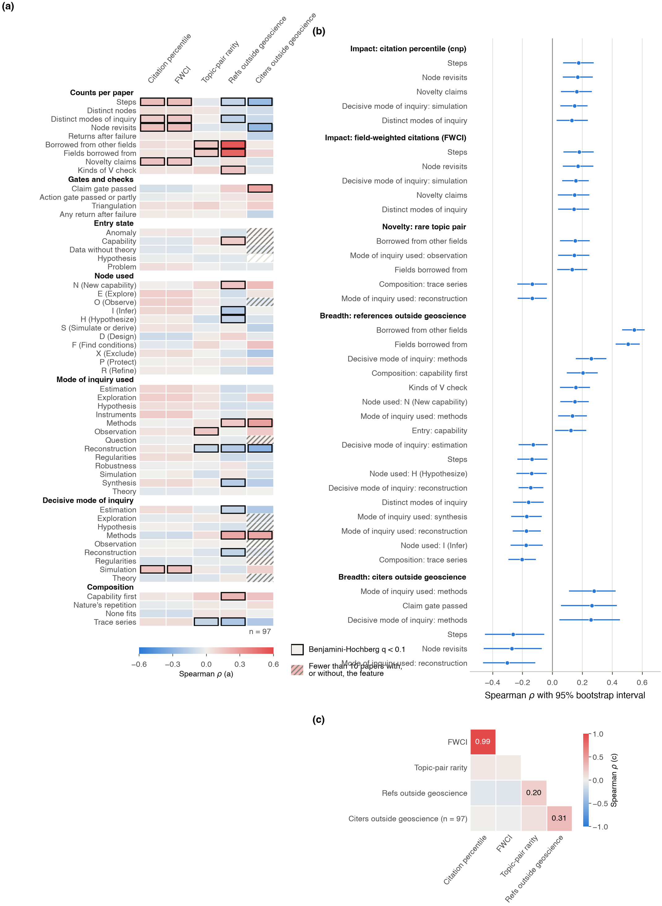

# Research workflows and their outcomes {.unnumbered}

[Drafted]{.status .drafted} [v0.4 · October 27, 2026 · round 1, 374 coded papers (exploratory) · round 2, 198 coded papers (confirmatory test of 43 frozen associations) · paper codebook 1.5.0 · advance: model judgment of reported warrant, 545 papers, October 28 · model-coded, no human check yet]{.status-line}

- **Question.** Do the workflow features coded from a paper (where it starts, which graph nodes and modes of inquiry it uses, how often it loops back, how it checks its result) go with its outcomes: impact, novelty, breadth, advance? And do the associations found in a first sample hold in a second one? A mode of inquiry is a kind of epistemic work, such as estimation, reconstruction from traces or methods.
- **Short answer.** Weakly, and most did not hold. At the first round-1 analysis (233 papers), 15 of 245 feature-outcome tests passed the Benjamini-Hochberg false-discovery threshold (q < 0.1, defined [below](#measures)). A plan frozen before any round-2 coding had been collected or read predicted that they would hold. Round 2 (198 papers) confirmed 4 of the 15, all with breadth of references, and none of the 6 citation tests or the 1 novelty test. Advance is measured only as a blind model judgment, not yet checked against people: under a second frozen plan, 8 of 9 workflow-feature links held, two of them consistency checks between codings of the same construct, most of them small ([below](#advance)).
- **For geoscientists.** At the first round-1 analysis (233 papers), papers with a longer coded workflow, more returns to earlier steps, or a main claim resting on a simulation were cited a little more (rank correlation 0.20 to 0.23; 0.15 to 0.18 on all 374 round-1 papers). In round 2 the same correlations are −0.03 to 0.03. Round 2 cannot tell whether the round-1 link came from selection, the journal mix or the population; AGU and Copernicus papers are both longer and more cited in round 1. What held, weakly (rho about 0.18) and on features the coder reproduces below the 0.667 threshold: papers that build a new capability before posing their question cite more work from outside geoscience, and papers that synthesize across studies cite less.
- **For NLP researchers.** The workflow features are structured extractions by one LLM (Claude Opus 5.5) under a written codebook. Outputs pass a format check; their run-to-run stability is measured, their accuracy is not (human coding has not started). Outcomes are bibliometric, from OpenAlex. Round 2 is a held-out test with hypotheses, decision rule and code fixed before its data were seen, on a shifted distribution (open access only, many more journals, few papers in the small round-1 subfields), so it tests transport to a new population as much as replication. Of 43 associations selected at q < 0.1 from 349 exploratory tests run without prior hypotheses (245 here, 104 on [topics and journals](topics-journals.qmd)), Benjamini-Hochberg expects about 4 to be false. Most of the 31 non-confirmations come from round-1 effect sizes inflated by selection, from round-2 groups too small to test, and from the change of population, not from 31 false positives.
- **Scope.** Codings with quotes, derived tables and figure provenance are public in the data release, [`data/roadmap-release/`](https://github.com/Denolle-Lab/metascience-and-AI/tree/framework-v0.5/data/roadmap-release). The confirmatory plan is public: [`preregistration/round2-confirmatory.md`](https://github.com/Denolle-Lab/metascience-and-AI/blob/framework-v0.5/preregistration/round2-confirmatory.md). Erratum, October 27, 2026: the frozen plan says it was committed before any round-2 coding existed. More exactly, it was committed before any round-2 coding was retrieved or read: the two main round-2 batches were submitted at 01:37 and 08:40 that day, the plan was pushed at 16:45, and the first round-2 coding was downloaded at 20:55. The frozen file is left unchanged. Paper texts, abstracts and review texts are not redistributed. Per-paper records of the papers in human coding are held back until that coding is done.

## Measures

Terms used on this page, on [topics and journals](topics-journals.qmd) and on [what review changes](review-visibility.qmd). The graph itself is on [the unit of analysis](unit.qmd).

**Rounds**

- **Round 1.** 525 eligible papers, 374 with a valid coding (tag `calc1`). Exploratory.
- **First analysis.** The 233 round-1 codings available on October 26, 2026. The confirmatory plan was written from these. The other 141 round-1 codings are the **top-up**, coded on October 27 (`tools/roadmap/rounds.py` holds the split rule).
- **Round 2.** 222 eligible open-access papers drawn from the rest of the pool, 198 with a valid coding (tag `r2`). Confirmatory for the 43 frozen associations, exploratory for everything else.
- **Pooled.** Both rounds together, 572 papers, with round as a stratum (ranks and permutations within round). Descriptive only, not part of the test.

**What is coded**

- **Node.** One of 15 kinds of move on the graph of inquiry: N new capability (build or characterize an instrument or method), E explore (establish that a phenomenon is real), O observe, I infer a latent quantity through a forward model (an inverse problem), Q question, H hypothesize rivals, S simulate or derive expectations, D design the test, F find or set the conditions, C compare, V vary or replicate (sensitivity tests, comparisons with independent data or methods, controls, reruns), X exclude a rival, K keep the claim, P protect the claim by revising an auxiliary assumption, R refine.
- **Mode of inquiry.** One of 13 kinds of epistemic work that a step serves, each named by the gain it aims at and the evidence its claims owe: observation, exploration, question, hypothesis (testing among rivals), theory (consequences from first principles), simulation (model forecasts or consequences), instruments (building or characterizing an apparatus), methods (a new inference or computational capability), synthesis (combining results across studies), reconstruction (a past event from its traces, as in paleoclimate or past earthquakes), robustness (varying conditions to see whether a result holds), estimation (a latent quantity with its uncertainty), regularities (an empirical relation with its range).
- **Walk.** The coded sequence of steps in the published paper, each step a node with a mode of inquiry.
- **Steps.** Number of steps in the walk as coded; consecutive steps on the same node count separately (median 22 in both rounds; merging them gives a median of 20).
- **Revisits.** Steps whose node already occurred earlier in the walk (median 12 in round 1, 11.5 in round 2). A consecutive repeat counts, so revisits overlap with steps: 15% of round-1 revisits are consecutive repeats.
- **Decisive mode of inquiry.** The mode of inquiry of the single step without which the paper's main claim would not exist. "Decided by simulation" means that step has simulation as its mode of inquiry.
- **Entry state.** How the paper starts: an anomaly, an unsolved problem, a challenged result, a hypothesis, data without theory, a new capability, or an external goal.
- **Claim status.** What the paper ends with: a confirmed claim, a regularity with its range, an estimate with resolution, a characterized capability, and so on.
- **Composition.** The overall shape of the workflow. "Capability first": the paper builds a new capability before it poses its question. "Trace series": conditions found in nature rather than set, with observations repeated over independent natural records (sediment cores, deposits, landforms), ending in the best explanation among stated rivals; "trace" means a natural record, not a seismic trace. "Nature's repetition": many natural events (for example many earthquakes) used as quasi-replicates to fit a regularity.
- **Borrowed from other fields.** The number of concepts, methods, instruments or data from outside Earth science that the coder lists for the paper (codebook section 6). **Fields borrowed from**: the number of distinct source fields.
- **V status and kinds of V check.** Each check the paper performs on its own result is coded by kind: reproduction (rerun on the same data), replication (new data), method (a second method), robustness (varied parameters or processing), control (a reference, a synthetic test, a null model), generalization (another region or context). V status is full when the paper performs at least one check other than a plain rerun, partial when its only checks are reruns, and none otherwise. The terms reproduction, replication and generalization follow NASEM [-@nasem2019]; V status counts internal checks and does not mean the result was replicated by others. In round 1, 365 of 374 papers are full and 9 none (round 2: 191 of 198 full); the most common kinds in round 1 are control (324 papers), robustness (238), replication (205) and method (193).
- **Valid coding.** The model's output passes the format check of `tools/check_coding.py`: required fields, allowed values, steps numbered in order, quotes of 25 words or fewer. The check says nothing about whether the coding is right. Every n on these pages counts valid codings. 9 papers (5 round 1, 4 round 2) failed the check twice and are excluded from every analysis.

**Outcomes**

- **cnp (impact).** OpenAlex citation-normalized percentile: the paper's citation count as a percentile among works of the same OpenAlex subfield, publication year and type, 0 to 1, about four years after publication. The reference set follows the OpenAlex subfield label, so a seismology paper that OpenAlex files under Artificial Intelligence is ranked against AI works ([topics and journals](topics-journals.qmd)). Both rounds were drawn with equal numbers per cnp quintile, so the sample medians (0.56 in round 1, 0.55 in round 2) are below the pool median (0.75).
- **FWCI (impact).** Field-weighted citation impact: citations divided by the mean for works of the same subfield, year and type (1 is the world average). Citations are right-skewed, so the median paper sits below 1 (0.57 in round 1, 0.58 in round 2). cnp and FWCI correlate at 0.99.
- **novelty_pair (novelty).** −log10(1 + number of 2017 to 2021 works whose two leading OpenAlex topics are the same pair as the paper's). Higher means a rarer pair. Median −3.85 in both rounds, which means about 7,000 earlier works share the pair; the most common pair has about 46,000. With about 4,500 OpenAlex topics, a pair of topics is a coarse unit.
- **breadth_refs (breadth).** Share of the paper's classified references (those with an OpenAlex topic) that lie outside geoscience. Geoscience is the OpenAlex fields Earth and Planetary Sciences and Environmental Science, plus topics filed elsewhere that a manual audit marked as geoscience (seismology, paleomagnetism, seismic instrumentation, among others). Median 0.028 in round 1, 0.038 in round 2.
- **breadth_citers (breadth).** The same share for citing works, for papers with at least 10 citers after removing self-citations: 97 of 374 round-1 papers, 55 of 198 round-2 papers.
- **Advance.** Blind human rating of the paper's contribution: pending. The model's blind judgment of reported warrant is [below](#advance). **Success fraction**: achieved papers over all papers judged, unassessable included.

**Statistics**

- **Spearman rho.** Rank correlation between a feature and an outcome, −1 to 1; binary features scored 0/1.
- **Bootstrap interval.** 2.5 and 97.5 percentiles of rho over 2000 resamples of papers. At 374 papers its half-width is about ±0.10 (median over the 220 tests that use all 374 papers; range 0.07 to 0.13); at 198 papers, 0.14 to 0.16 for the citation tests.
- **Permutation p.** Share of 5000 shuffles of the outcome giving a correlation at least as large in absolute value. The smallest attainable p is 1/5001.
- **BH q.** Benjamini-Hochberg adjusted p [@benjamini1995]; q < 0.1 means at most about 10% of the findings below the threshold are expected to be false. It holds when tests are independent or positively dependent, which is the expected case here. Families on this page: 245 tests at the first analysis, 274 tests at 374 round-1 papers, 310 pooled tests, and the 43 confirmatory tests; each is adjusted separately. Families on [topics and journals](topics-journals.qmd) are listed there.
- **Benjamini-Yekutieli q.** The same adjustment made valid under any dependence, by multiplying BH q by the sum of 1/i over the tests (6.19 for 274 tests). Used as a sensitivity check.
- **Partial rho.** Feature and outcome ranks each regressed on the rank of reference count; the correlation of the residuals.
- **Confirmed, reversed, not confirmed.** The verdicts of the round-2 test. Confirmed: round-2 BH q < 0.1 over the 43 tests and the predicted direction. Reversed: q < 0.1 and the opposite direction. Not confirmed: anything else. A non-confirmation is not evidence that an association is zero, except where the round-2 interval excludes the round-1 size.
- **Run-to-run consistency (test-retest).** The same model codes the same paper twice, independently. It measures stability, not accuracy. It does not cap or estimate agreement with human coders, and errors the model repeats on every run do not show.
- **Node-set overlap.** Jaccard index of the sets of nodes in two codings of one paper: shared nodes over nodes in either.
- **Krippendorff's alpha.** Agreement between two codings corrected for chance [@krippendorff2019]; 1 is perfect, 0 is chance; 0.667 and 0.8 are the usual thresholds for tentative and firm conclusions. When nearly all papers fall in one class, alpha rests on one or two papers and says little.
- **Cliff's delta.** Probability that a coded paper scores higher than an uncoded one minus the reverse, −1 to 1 [@cliff1993].
- **Wilson interval.** A binomial confidence interval that stays inside 0 to 1 for small counts [@wilson1927].

## Annotation setup

- **Coder.** `claude-opus-5-5` through Anthropic's asynchronous batch mode (half price), effort setting high, maximum 32,000 output tokens (64,000 allowed for a retry after hitting the limit; no round-1 request used it), no temperature set (API default), no thinking parameter set. One fixed instruction set: codebook 1.5.0 (public commit 01b7f78) and its JSON schema, 29,568 characters, sha256 `9e8d9aad…dfc462` (sha256 is a fingerprint of the file, which changes if one byte changes). The paper goes in as PDF, plus publisher XML text where it existed at submission (177 of the 374 valid round-1 codings; 197 were coded from the PDF alone).
- **Other model steps.** The abstract screen used two model calls per abstract that did not see each other's answer and a third on disagreements (model id not recorded). The agent-loop comparison used a Claude Opus run and a Claude Sonnet run. Every step uses Claude models; no model from another family has been run.
- **Dates.** First-analysis batches submitted October 25, 2026; the round-1 top-up batch, its retries and round 2 on October 27.
- **Cost.** $0.30 per paper for the main coding of each round; $221.59 recorded for all experiments, under a $250 cap (raised to $400 on October 27, 2026).

## Corpus

{fig-alt="Horizontal bars: round 1, 600 preselected, 525 eligible, 379 full text, 374 coded; round 2, 277 drawn, 222 eligible, 202 full text, 198 coded."}

- **Pool.** 14,223 articles from 2022 in OpenAlex (the open bibliographic index that supplies journals, citations and topic labels), restricted four ways: 16 topics and subfields chosen around the convenor's (the study's principal investigator's) work; publishers with a full-text route (Elsevier, Wiley and AGU, Springer Nature, Copernicus, Science Advances, Seismica, Geophysical Journal International, Seismological Society of America journals); at least 15 references; an Earth-science or multidisciplinary venue. MDPI, Frontiers, Taylor & Francis and others are not in the pool. The results describe this pool, not 2022 Earth science as a whole.
- **Rings.** The core ring is the convenor's own 8 OpenAlex topics (seismology, seismic waves and imaging, earthquakes and tectonics, seismic sensors, cryosphere, high-pressure geophysics); the broad ring is 8 Earth-science subfields. The core ring is 19% of the pool and half of round 1.
- **Round 1 preselection.** 600 papers, half per ring, equal numbers per cnp quintile, subfields taken in turn. Eligibility: an abstract screen by model calls (no human audit), 525 eligible.
- **Round 2 draw.** 277 open-access papers from the rest of the pool, per ring with equal numbers per cnp quintile where the pool allowed, at most 4 per journal (seed 2027): 157 journals, 12 publishers. 222 eligible, 202 with full text, 198 coded, from 114 journals. Round 2 differs from round 1 in population as well as in sample: open access only, and spread over many more journals.
- **Gold set.** A frozen sample of 100 of the 525 eligible round-1 papers, stratified by ring and by terciles of impact, novelty and breadth. "Gold" names the sample, not its labels: no human labels exist yet. 51 of the 100 had full text at the first coding and were coded a second time; 50 pairs pass the format check. 40 are assigned to four human coders, two per paper; 0 of 40 coded.
- **Coding complete.** No batch is pending. Round 1: 374 of 379 papers with full text have a valid coding; round 2: 198 of 202.

{fig-alt="Stacked bars by publisher: Copernicus, Nature Portfolio and AGU fully retrieved; SSA journals, GJI and Springer translation journals mostly without full text."}

- **Still without a PDF, round 1.** 146 of 525 eligible papers (2 of them have publisher XML): mostly Seismological Society of America journals (44), Pleiades and Allerton English translations of Russian-language journals, distributed by Springer (54; paywalled, no text-and-data-mining route), and Geophysical Journal International (28). Round 2: 20 of 222.
- **Who is coded, round 1.** The 374 coded papers lean toward open access (82% against 15% of the 151 eligible papers not coded) and are more cited (median cnp difference +0.20 [+0.14, +0.24]), largely because many uncoded papers are in the Springer translation journals. Topic-pair rarity does not differ; references outside geoscience are slightly fewer in coded papers. 33 come from one journal (The Cryosphere).
- **Who is coded, round 2.** cnp does not differ between the 198 coded and 24 uncoded papers; coded papers have slightly more common topic pairs (Cliff's delta −0.23 [−0.43, −0.03]).

{fig-alt="Box plots by stage for rounds 1 and 2; in round 1 coded papers are far more often open access and somewhat more cited than eligible papers not coded."}

## Run-to-run consistency of the model coder

{fig-alt="Dot plots: entry state, outcome and decisive mode of inquiry match in most papers; node-set overlap 0.86; Krippendorff's alpha 0.6 to 1 across variables."}

- **Same model, same paper, two runs (50 round-1 papers of the gold set).** Node-set overlap 0.86 (0.65 for two different papers); decisive mode of inquiry matches in 86% of papers; Krippendorff's alpha 0.74 for node presence and 0.60 to 0.83 for entry state, claim status, decisive mode of inquiry and composition. Outcome and V status: both runs agree on all 50 papers, but 49 of 50 fall in one class, so alpha (1.0 as a point estimate, undefined in a third of bootstrap resamples) says little.
- **The features behind the associations.** Counts, rank correlation between the two runs: steps 0.76, revisits 0.76, distinct modes of inquiry 0.83, kinds of V check 0.85, borrowed from other fields 0.87, fields borrowed from 0.81. Binary features, alpha: decisive methods 1.0, decisive simulation 0.74, uses observation (mode of inquiry) 0.73, uses node I 0.74, uses synthesis (mode of inquiry) 0.65, capability-first composition 0.63. The last two are below the 0.667 threshold, and both were confirmed in round 2.
- **Format test (6 papers, earlier codebook 1.4.0, two pipelines).** Not comparable with the panel above; shown for the input-format question only.
- **Human check.** None yet. This is the main gap.

## Associations in round 1 (exploratory)

{fig-alt="Heat map of feature-outcome correlations with 38 outlined cells; interval plot of the 38, between 0.12 and 0.55 in absolute value; outcomes nearly independent except citation percentile and FWCI."}

- **The 15 of the first analysis.** At 233 papers, 15 of 245 tests passed q < 0.1, with |rho| from 0.18 to 0.57. Because cnp and FWCI are one signal, these are 12 distinct associations. All 15 keep their sign and q < 0.1 at 374 papers, which include the 233 and so do not check them independently. Round-2 verdicts in brackets:
  - **Impact** [not confirmed, all 6]. Steps, revisits and a decisive simulation step: rho 0.20 to 0.23 with cnp and FWCI at 233 papers, 0.15 to 0.18 at 374.
  - **Breadth of references, positive.** Capability-first composition (0.22 at 233, 0.20 at 374) [confirmed]; decisive methods (0.22, 0.26) [not confirmed]; kinds of V check (0.20, 0.16) [not confirmed].
  - **Breadth of references, negative.** Synthesis as a mode of inquiry (−0.22, −0.17) [confirmed]; distinct modes of inquiry (−0.22, −0.16) [not confirmed]; node I used (−0.18, −0.18) [not confirmed].
  - **Novelty.** Observation as a mode of inquiry (0.21, 0.15) [not confirmed].
  - **Convergent validity check.** Items borrowed from other fields (0.57, 0.55) and fields borrowed from (0.51, 0.51) with breadth_refs [both confirmed]. See below.
- **At 374 papers.** 38 of 274 tests pass q < 0.1, |rho| 0.12 to 0.55; at most about 4 (0.1 × 38) are expected to be false under the Benjamini-Hochberg assumptions. 23 are outside the 15, among them trace-series composition (−0.20) and reconstruction as a mode of inquiry (−0.17) with breadth_refs, and the number of novelty claims with cnp (0.16). None of the 23 was in the plan or has been tested on an independent sample.
- **Breadth of citers** (97 papers): six tests pass, |rho| 0.26 to 0.30, among them methods as a mode of inquiry (0.28) and reconstruction (−0.30). None was in the plan.
- **Outcomes are nearly independent** of each other (|rho| at most 0.10 between impact, novelty and breadth), except cnp with FWCI (0.99), novelty_pair with breadth_refs (0.20) and the two breadth measures (0.31).
- **Paper length check.** Longer papers have more steps and more citations. Controlling for reference count, the round-1 impact correlations at 374 drop: steps 0.17 to 0.11, revisits 0.17 to 0.10, decisive simulation 0.15 to 0.14 (with cnp). Counting revisits without consecutive repeats changes nothing (0.17 with cnp, 0.18 with FWCI; a sensitivity check outside the 274 tests).
- **A check of the coder, not an outcome result.** The count of items borrowed from other fields (0.57 at 233, 0.52 in round 2) and the number of fields borrowed from (0.51, 0.48) measure the same thing as breadth_refs: one from the text, as the coder reads it, one from the reference list. Their agreement is a convergent validity check of the coder, not a finding about workflows and outcomes.
- **Stricter correction.** Under Benjamini-Yekutieli, 8 of the 274 tests pass (smallest q 0.057); at the first analysis none of the 245 did. With 5000 permutations no p can fall below 0.0002.
- **Field and venue.** Recomputed within strata on the same 374 papers, the 38 keep their sign and q < 0.1 in 31 cases within subfield, 36 within journal family and 24 within subfield × family (25, 35 and 21 with an interval excluding 0). Holding subfield fixed removes 7 rows, all breadth or novelty (among them items borrowed from other fields with novelty_pair, and steps with breadth of citers). Holding family fixed removes distinct modes of inquiry with cnp and with FWCI and shrinks the other citation correlations (steps with cnp: 0.17 to 0.11). The 15 of the first analysis survive in 15, 15 and 14 cases (13, 15 and 12 with an interval excluding 0); surviving did not predict round 2, since 4 of the 14 that survive all three were confirmed. Details on [topics and journals](topics-journals.qmd).

## Confirmatory test (round 2) {#confirmatory-test}

- **Design.** On October 27, 2026 the principal investigator (PI) decided that round 1 is exploratory, that round 2 tests the round-1 associations, and that both rounds are also reported pooled for description. `tools/roadmap/g23_confirmatory.py freeze` read the first-analysis results (233 papers) and wrote the plan, [`preregistration/round2-confirmatory.md`](https://github.com/Denolle-Lab/metascience-and-AI/blob/framework-v0.5/preregistration/round2-confirmatory.md) and its machine-readable `.json`, public commit b4369fe. The freeze refuses to run if any round-2 coding file exists; the plan records 0. No round-2 coding had been collected or read at the freeze, although the two main round-2 batches had been submitted that morning (see the erratum above). The plan's groups come from the 233 first-analysis papers, which held 16 AGU and 9 Elsevier papers, so Elsevier is pooled.
- **Hypotheses.** 43: H01 to H15 are the 15 feature-outcome associations of this page, predicted to keep their sign; H16 to H43 are the 28 field and venue associations of [topics and journals](topics-journals.qmd), 14 by journal family and 14 by subfield.
- **Rule.** One family of 43 tests, BH q over the round-2 permutation p values, verdicts as defined in [Measures](#measures). Same features, outcomes, statistics functions and seed fixed in the plan, with the sha256 of the code and the codebook.
- **Two invocations, one output.** `g23_confirmatory.py test` was invoked twice on the 198 round-2 papers. The first stopped at writing the output with a serialization error before any result was written or shown; after a two-line fix (public commit cb6dcfd) that converts numpy booleans so the results can be written as JSON, with no change to data, statistics or rule, the second wrote the results. Its output records the plan's sha256, which matches. Read from the run record; the test was not rerun for this page.

{fig-alt="Interval plots pairing round-1 and round-2 estimates for 43 associations. Citation and novelty rows fall to about zero in round 2; the borrowed-from-other-fields rows, capability first and synthesis hold; subfield differences in reconstruction and in the decisive mode of inquiry hold; most journal-family rows fall to about zero."}

- **Verdict.** 12 confirmed, 0 reversed, 31 not confirmed; among the 31, 9 changed sign without reaching q < 0.1 and 2 rest on a single round-2 paper. The 12 are 2 convergent validity checks, 2 whole-variable associations with no direction, 3 rows on the same 3 round-2 papers, 1 pass by sign only and 4 directional confirmations (H03, H11, H20, H21). Under Benjamini-Yekutieli, 6 of 43 would be confirmed. By kind: citations 0 of 6, novelty 0 of 1, breadth 4 of 8, subfield 6 of 14, journal family 2 of 14.
- **Confirmed on this page (4 of 15),** first analysis then round 2: items borrowed from other fields (H02; rho 0.57, then 0.52; q 0.003) and fields borrowed from (H01; 0.51, then 0.48; q 0.003), both the convergent validity check; capability first (H03; 0.22, then 0.18; q 0.056); synthesis as a mode of inquiry (H11; −0.22, then −0.18; q 0.058).
- **Not confirmed, citations (6 of 6).** Steps, revisits and decisive simulation, each with cnp and FWCI: rho 0.20 to 0.23, then −0.03 to 0.03. The round-2 intervals end at 0.126 to 0.169: they exclude the first-analysis size (0.20 to 0.23) and, narrowly, the 374-paper values (0.15 to 0.18), and include 0.06 to 0.09. Round 2 excludes the selected round-1 estimate, not a correlation of 0.05 to 0.10.
- **Not confirmed, novelty (1 of 1).** Observation as a mode of inquiry with topic-pair rarity: 0.21, then 0.01.
- **Not confirmed, breadth (4 of 8).** Decisive methods (0.11, q 0.27), kinds of V check (0.12, q 0.26) and node I (−0.02, q 0.94) keep the predicted sign without passing; distinct modes of inquiry turns positive (0.02, q 0.91).
- **Field and venue (8 of 28 confirmed).** Listed on [topics and journals](topics-journals.qmd#round-2-what-replicated).

**Why most did not hold.** Four readings, not exclusive.

- **Selection.** The 15 were picked for passing q < 0.1 among 245 tests, and estimates selected that way are inflated. On the 141 top-up papers, which are almost all AGU (79) and Elsevier (61) papers whose full text arrived on October 27, the six citation correlations are 0.06 to 0.09. This fits inflation by selection, but the top-up differs from the first analysis in venue, so it cannot separate inflation from venue; and decisive methods with breadth went up there (0.31, against 0.22 at 233 and 0.11 in round 2). The confirmed borrowed-from-other-fields link moved least (0.57, 0.48 in the top-up, 0.52 in round 2). This use of the top-up is post hoc.
- **Venue.** Within journal family the round-1 correlation of steps with cnp fell to 0.11. Round 2 spreads its papers over 114 journals; there it is 0.02 overall and −0.01 within family. Round 2 cannot tell this reading from the others.
- **Population.** Round 2 is open access only, with at most 4 papers per journal, drawn by publisher rather than subfield rotation. Both rounds are drawn with equal numbers per cnp quintile (round 2: 37 in the lowest), so the citation range is similar by design; the population differs in venue and field mix (Earth-Surface Processes 37 to 3 papers, Springer Nature (other) 12% to 25% of coded papers, AGU 25% to 15%), which bears on the field and venue rows rather than the citation rows. Round 2 also has publisher XML for a larger share of codings (123 of 198 against 177 of 374), and the input format changes the coded sequence.
- **Power.** At 198 papers, power to detect rho 0.20 is 0.81 at alpha 0.05 and 0.42 at the first-rank BH threshold (0.1/43); for rho 0.075 it is 0.02 to 0.18 (Fisher z, post hoc). Detecting rho 0.08 with 80% power at alpha 0.05 needs about 1,200 papers, and rho 0.06 about 2,200, 6 to 11 times round 2, and more under a BH family of 43.

**Pooled description.** Over 572 papers with round as a stratum, 42 of 310 tests pass q < 0.1. This is description, not a test, and it adds no confirmed result.

## Advance (model judgment) {#advance}

{fig-alt="Model verdicts on 545 papers, about two thirds achieved; success fraction by journal family from 0.51 to 0.78; eight of nine frozen workflow-feature tests positive, several smaller after adjustment."}

- **What advance means.** The primary outcome on [scientific advance](rubrics.qmd): a meaningful, warranted improvement in knowledge, understanding or research capability, judged against what was known before the work. Verdict achieved, not demonstrated or unassessable; unassessable papers stay in the denominator.
- **What the model measures.** A model cannot inspect data, figures or supplements, so the coder (`claude-opus-5-5`, effort medium, rubric [`agents/advance/RUBRIC.md`](https://github.com/Denolle-Lab/metascience-and-AI/blob/framework-v0.5/agents/advance/RUBRIC.md) v1.1.0) judges *reported warrant*: whether the text documents the gain. A gain is achieved when it meets six criteria: M1 beyond what was known; M2 meaningful for its type (a changed prior value, a named test between rivals, or a reported comparison for a method); W1 rests on evidence in this paper; W2 uncertainty stated; W3 the main alternative explanation checked; W4 no internal contradiction. "Not demonstrated" means the text does not show the gain, not that the result is wrong.
- **Advance score.** 1 no warranted gain; 2 small, local; 3 clear gain for one subfield; 4 substantial, others will build on; 5 resolves a recognized problem or opens a new line of work. The same anchors as the human form. Not demonstrated takes 1 by rule.
- **Blinding and its limit.** Journal, publisher, authors, affiliations, dates, funding and DOI are removed from the text. Venue still shows: from the blinded text the model names the journal for 50 of 60 papers (83%), and from title and abstract alone for 67 of 80 (84%). From title and abstract its citation guesses correlate with real citations at rho 0.51, although it says it recognizes 2 of 80 papers.
- **Pilot.** 20 papers coded twice; for the 19 valid in both runs, verdict and score are identical. This is stability, not accuracy.
- **Plan.** Frozen before any full-run coding: [`preregistration/advance-plan.md`](https://github.com/Denolle-Lab/metascience-and-AI/blob/framework-v0.5/preregistration/advance-plan.md), public commit f7ca019 ([erratum](https://github.com/Denolle-Lab/metascience-and-AI/blob/framework-v0.5/preregistration/ERRATA.md): frozen by Claude Code on the PI's instruction). Nine hypotheses, each a workflow feature predicted to go with the model's verdict, score or role; Spearman rho within round × subfield, BH q < 0.1 with the predicted sign.
- **Result.** 545 papers of both rounds (19 pilot papers with a full-run coding and 8 invalid codings excluded): 354 achieved, 191 not demonstrated, 0 unassessable. Success fraction 0.65 [0.61, 0.69]; 0.66 in round 1, 0.63 in round 2. Scores are compressed: 197 papers at 2, 156 at 3, one at 4, none at 5.
- **8 of 9 supported.** Triangulation, kinds of check, the claim gate, the action gate and any return after failure go with the verdict or score at rho 0.09 to 0.30. Holding paper length, text route and the coder's own count of checks fixed (plain to adjusted rho), triangulation falls from 0.20 to 0.10, kinds of check from 0.32 to 0.16 and return after failure from 0.10 to 0.02; the claim-gate links keep most of their size.
- **Two are consistency checks.** A contradicted outcome with the corrective role (0.35) and capability first with the enabling role (0.41) pair codes of nearly the same thing, made by the same model from the same text. Fields borrowed from with the integrative role: −0.04, not supported.
- **Venue.** Among journal families with 10 or more papers, success fraction runs from 0.51 (Wiley non-AGU, 93 papers) to 0.78 (Copernicus, 100); Cramér's V (association strength, 0 to 1) 0.23 bias-corrected, 0.30 within round. The model can tell the venue, and journals shape what papers report (length limits, data statements, open review), so this mixes real differences in reported warrant with a possible halo. The design cannot separate them. Within journal family the nine estimates move by at most 0.03.
- **Calibration.** The model's blind impact forecast correlates with citation percentile at 0.47, its advance score at 0.28. On the same 74 papers the full-text forecast reaches 0.46 against cnp and the title-and-abstract guess 0.52, so the forecast shows no judgment beyond recall or topic. No coding used the top-decile forecast, so it is in effect a 1 to 3 scale.
- **For geoscientists.** A paper whose uncertainty and checks of the main alternative are in the text scores higher than one that keeps them in a supplement. That is what reported warrant measures.
- **For NLP researchers.** Perfect retest agreement, agreement between two prompts of one model, and a citation correlation of 0.47 bound the noise of the judge, not its validity, and are compatible with a judge that recalls rather than reads.
- **Not yet advance.** Validation gate: 40 gold-set papers rated by two of the four lab coders each, without the model codings; human-human Krippendorff's alpha at least 0.667 on the score, and on the verdict once the form records one, model-human alpha within 0.10 of it, mean score difference within ±0.5. 0 of 40 rated. Until it passes, these numbers are the model's judgment of reported warrant.

## Reading the result

- **For geoscientists.** No workflow feature has a confirmed link to citation or to topic-pair rarity. The breadth results that stand are two weak links: papers that build a capability first cite more outside geoscience, papers that synthesize across studies cite less. The round-1 citation pattern was not confirmed; round 2 cannot tell selection, population and venue apart, and the reading that it described the journal mix of round 1 is a hypothesis for a third sample.
- **For NLP researchers.** Of 15 exploratory associations that passed q < 0.1, a pre-registered held-out test on a shifted distribution kept 4, two of which restate the reference list. Every verdict is conditional on one model coder, the same in both rounds. The round-1 estimates near 0.2 had intervals of about ±0.13 and were inflated by selection. Both rounds were drawn with equal numbers per cnp quintile, so correlations with cnp describe this design, not the 2022 population; no inverse-probability weighting has been applied.
- None of this is causal. Open access, team size and topic differ between papers and are not controlled here; field and venue are checked on [topics and journals](topics-journals.qmd).
- Novelty as measured (a rare topic pair) barely relates to any workflow feature, and the one round-1 link did not hold. Either the proxy is weak or novelty does not show in the workflow; the blind human ratings should help separate the two.

## Limits

- One model coder (Claude Opus 5.5) and Claude models at every other step; run-to-run node overlap 0.86 on 50 papers; no human check and no cross-model check yet. A run of an open-weight model (one whose weights are public and can be served locally) through `tools/code_papers_open.py` on the same 50 papers is prepared but not run.
- Possible contamination: the papers are from 2022 and the model's knowledge cutoff is June 2026, so the papers and their reception are probably in its training data. The coder may draw on memory as well as on the text. Not tested; a probe would code from title and DOI alone and compare.
- Round 1: 374 of 525 eligible papers, 82% open access; round 2: 198 of 222, open access by design. Citations at about four years.
- Proxies: novelty and breadth are bibliometric stand-ins, not normalized by subfield; advance is one model's judgment of reported warrant, with venue knowable from the text and no human check yet.
- The confirmatory plan froze the values at 233 papers, before the top-up. It contains no test of the 23 associations that reach q < 0.1 only at 374 papers; those stay exploratory. A citation claim would need a third sample drawn for it.
- 274 round-1 tests: at most about 4 (0.1 × 38) of the 38 at q < 0.1 are expected to be false positives under the Benjamini-Hochberg assumptions.

## Reproduce

- Round-1 and pooled associations: `tools/roadmap/g17_outcomes.py` (this repository); inputs are the codings in `analysis/codings/api/calc1/` and `r2/` and `data/roadmap/derived/gold/metrics.json`, in the data release. Round-1 split: `tools/roadmap/rounds.py`.
- Confirmatory test: plan [`preregistration/round2-confirmatory.json`](https://github.com/Denolle-Lab/metascience-and-AI/blob/framework-v0.5/preregistration/round2-confirmatory.json) (commit b4369fe); `tools/roadmap/g23_confirmatory.py test`, run once by design and not part of the rebuild; output `data/roadmap/derived/confirmatory/results.json`.
- Advance: plan [`preregistration/advance-plan.json`](https://github.com/Denolle-Lab/metascience-and-AI/blob/framework-v0.5/preregistration/advance-plan.json) (commit f7ca019); `tools/roadmap/g24_advance.py test`, run once on the frozen plan; leak probes `tools/roadmap/g25_leak_probes.py`. Figure: `tools/roadmap/figures/fig15_advance.py`.
- Reported numbers, including the run-to-run consistency of each feature, the sensitivity checks and the confirmatory summary: `tools/roadmap/g19_report_numbers.py`. Figures: `tools/roadmap/figures/` (fig01, fig02, fig03, fig08, fig09, fig14, fig15).
