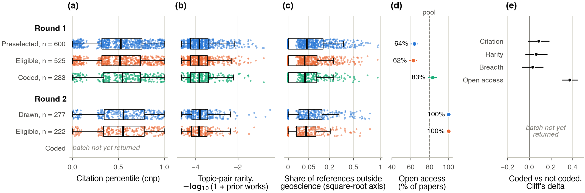

# Research workflows and their outcomes {.unnumbered}

[Drafted]{.status .drafted} [v0.3 · October 27, 2026 · round 1, 233 coded papers · paper codebook 1.5.0 · model-coded, no human check yet · exploratory]{.status-line}

- **Question.** Do the workflow features coded from a paper (where it starts, which modes and graph nodes it uses, how often it loops back, how it checks its result) go with its outcomes: impact, novelty, breadth, advance?
- **Short answer.** Weakly. Of 245 feature-outcome tests, 15 pass the Benjamini-Hochberg false-discovery threshold (q < 0.1, defined [below](#measures)); because the two citation outcomes are nearly the same measure, these are 12 distinct associations. Their rank correlations lie between 0.18 and 0.57 in absolute value. Under a stricter correction that allows any dependence between tests, none passes. Advance is not measured yet.
- **For geoscientists.** Papers whose coded workflow is longer and returns to earlier steps, and papers whose main claim rests on a simulation, are cited a little more (rank correlation about 0.2); about half of that goes with the journal they appear in. Papers whose main claim rests on a new method cite more work from outside geoscience.
- **For NLP researchers.** The workflow features are structured extractions by one LLM (Claude Opus 5.5) under a written codebook. Outputs pass a format check; their run-to-run stability is measured, their accuracy is not (human coding has not started). Outcomes are bibliometric, from OpenAlex. The sample is stratified on one of the outcomes (citation percentile).
- **Scope.** Results only; codings and papers stay in the lab's private repository.

## Measures

Terms used on this page, on [topics and journals](topics-journals.qmd) and on [what review changes](review-visibility.qmd). The graph itself is on [the unit of analysis](unit.qmd).

**What is coded**

- **Node.** One of 15 kinds of move on the graph of inquiry: N new capability (build or characterize an instrument or method), E explore (establish that a phenomenon is real), O observe, I infer a latent quantity through a forward model (an inverse problem), Q question, H hypothesize rivals, S simulate or derive expectations, D design the test, F find or set the conditions, C compare, V vary or replicate (sensitivity tests, comparisons with independent data or methods, controls, reruns), X exclude a rival, K keep the claim, P protect the claim by revising an auxiliary assumption, R refine.
- **Mode.** One of 13 styles of inquiry that a step serves: observation, exploration, question, hypothesis (testing among rivals), theory (consequences from first principles), simulation (model forecasts or consequences), instruments (building or characterizing an apparatus), methods (a new inference or computational capability), synthesis (combining results across studies), reconstruction (a past event from its traces, as in paleoclimate or past earthquakes), robustness (varying conditions to see whether a result holds), estimation (a latent quantity with its uncertainty), regularities (an empirical relation with its range).
- **Walk.** The coded sequence of steps in the published paper, each step a node with a mode.
- **Steps.** Number of steps in the walk as coded; consecutive steps on the same node count separately (median 22; merging them gives a median of 20).
- **Revisits.** Steps whose node already occurred earlier in the walk. A consecutive repeat counts, so revisits overlap with steps: 15% of revisits are consecutive repeats.
- **Decisive mode.** The mode of the single step without which the paper's main claim would not exist. "Decided by simulation" means that step is in the simulation mode.
- **Entry state.** How the paper starts: an anomaly, an unsolved problem, a challenged result, a hypothesis, data without theory, a new capability, or an external goal.
- **Claim status.** What the paper ends with: a confirmed claim, a regularity with its range, an estimate with resolution, a characterized capability, and so on.
- **Composition.** The overall shape of the workflow. "Capability first": the paper builds a new capability before it poses its question.
- **Borrowed from other fields.** The number of concepts, methods, instruments or data from outside Earth science that the coder lists for the paper (codebook section 6). **Fields borrowed from**: the number of distinct source fields.
- **V status and kinds of V check.** Each check the paper performs on its own result is coded by kind: reproduction (rerun on the same data), replication (new data), method (a second method), robustness (varied parameters or processing), control (a reference, a synthetic test, a null model), generalization (another region or context). V status is full when the paper performs at least one check other than a plain rerun, partial when its only checks are reruns, and none otherwise. The terms reproduction, replication and generalization follow NASEM [-@nasem2019]; V status counts internal checks and does not mean the result was replicated by others. In round 1, 225 of 233 papers are full and 8 none; the most common kinds are control (203 papers), robustness (148), replication (119) and method (116).
- **Valid coding.** The model's output passes the format check of `tools/check_coding.py`: required fields, allowed values, steps numbered in order, quotes of 25 words or fewer. The check says nothing about whether the coding is right. Every n on these pages counts valid codings.

**Outcomes**

- **cnp (impact).** OpenAlex citation-normalized percentile: the paper's citation count as a percentile among works of the same OpenAlex subfield, publication year and type, 0 to 1, about four years after publication. The reference set follows the OpenAlex subfield label, so a seismology paper that OpenAlex files under Artificial Intelligence is ranked against AI works ([topics and journals](topics-journals.qmd)). Round 1 was drawn with equal numbers per cnp quintile, so the sample median (0.55) is below the pool median (0.75). 233 papers.
- **FWCI (impact).** Field-weighted citation impact: citations divided by the mean for works of the same subfield, year and type (1 is the world average). Citations are right-skewed, so the median paper sits below 1. 233 papers, median 0.48. cnp and FWCI correlate at 0.99.
- **novelty_pair (novelty).** −log10(1 + number of 2017 to 2021 works whose two leading OpenAlex topics are the same pair as the paper's). Higher means a rarer pair. Median −3.8, which means about 6,300 earlier works share the pair; the most common pair has about 46,000. With about 4,500 OpenAlex topics, a pair of topics is a coarse unit.
- **breadth_refs (breadth).** Share of the paper's classified references (those with an OpenAlex topic) that lie outside geoscience. Geoscience is the OpenAlex fields Earth and Planetary Sciences and Environmental Science, plus topics filed elsewhere that a manual audit marked as geoscience (seismology, paleomagnetism, seismic instrumentation, among others). 233 papers, median 0.03.
- **breadth_citers (breadth).** The same share for citing works, papers with at least 10 citers after removing self-citations. 53 papers, median 0.00.
- **Advance.** Blind human rating of the paper's contribution. Pending.

**Statistics**

- **Spearman rho.** Rank correlation between a feature and an outcome, −1 to 1; binary features scored 0/1.
- **Bootstrap interval.** 2.5 and 97.5 percentiles of rho over 2000 resamples of papers. At 233 papers its half-width is about ±0.13 (median over the 196 tests that use all 233 papers; range 0.10 to 0.15).
- **Permutation p.** Share of 5000 shuffles of the outcome giving a correlation at least as large in absolute value. The smallest attainable p is 1/5001.
- **BH q.** Benjamini-Hochberg adjusted p [@benjamini1995]; q < 0.1 means at most about 10% of the findings below the threshold are expected to be false. It holds when tests are independent or positively dependent, which is the expected case here. Families: the 245 tests on this page; on [topics and journals](topics-journals.qmd), 16 coverage tests, 104 workflow tests, 16 outcome tests and 45 stratified tests, each adjusted separately.
- **Benjamini-Yekutieli q.** The same adjustment made valid under any dependence, by multiplying BH q by 6.08 for 245 tests. Used as a sensitivity check.
- **Partial rho.** Feature and outcome ranks each regressed on the rank of reference count; the correlation of the residuals.
- **Run-to-run consistency (test-retest).** The same model codes the same paper twice, independently. It measures stability, not accuracy. It does not cap or estimate agreement with human coders, and errors the model repeats on every run do not show.
- **Node-set overlap.** Jaccard index of the sets of nodes in two codings of one paper: shared nodes over nodes in either.
- **Krippendorff's alpha.** Agreement between two codings corrected for chance [@krippendorff2019]; 1 is perfect, 0 is chance; 0.667 and 0.8 are the usual thresholds for tentative and firm conclusions. When nearly all papers fall in one class, alpha rests on one or two papers and says little.
- **Cliff's delta.** Probability that a coded paper scores higher than an uncoded one minus the reverse, −1 to 1 [@cliff1993].
- **Wilson interval.** A binomial confidence interval that stays inside 0 to 1 for small counts [@wilson1927].

## Annotation setup

- **Coder.** `claude-opus-5-5` through Anthropic's asynchronous batch mode (half price), effort setting high, maximum 32,000 output tokens (64,000 for a retry after hitting the limit; no round-1 request needed it), no temperature set (API default), no thinking parameter set. One fixed instruction set: codebook 1.5.0 (public commit 01b7f78) and its JSON schema, 29,568 characters, sha256 `9e8d9aad…dfc462`. The paper goes in as PDF, plus publisher XML text where it existed at submission (116 of the 233 valid codings; 117 were coded from the PDF alone).
- **Other model steps.** The abstract screen used two model calls per abstract that did not see each other's answer and a third on disagreements (model id not recorded). The agent-loop comparison used a Claude Opus run and a Claude Sonnet run. Every step uses Claude models; no model from another family has been run.
- **Dates.** Round 1 coded October 25 to 26, 2026; retries October 26.

## Corpus

{fig-alt="Horizontal bars: round 1, 600 preselected, 525 eligible, 379 full text, 379 submitted, 233 coded; round 2, 277 drawn, 222 eligible, 202 full text, 202 submitted, coding not returned."}

- **Pool.** 14,223 articles from 2022 in OpenAlex (the open bibliographic index that supplies journals, citations and topic labels), restricted four ways: 16 topics and subfields chosen around the convenor's (the study's principal investigator's) work; publishers with a full-text route (Elsevier, Wiley and AGU, Springer Nature, Copernicus, Science Advances, Seismica, Geophysical Journal International, Seismological Society of America journals); at least 15 references; an Earth-science or multidisciplinary venue. MDPI, Frontiers, Taylor & Francis and others are not in the pool. The results describe this pool, not 2022 Earth science as a whole.
- **Rings.** The core ring is the convenor's own 8 OpenAlex topics (seismology, seismic waves and imaging, earthquakes and tectonics, seismic sensors, cryosphere, high-pressure geophysics); the broad ring is 8 Earth-science subfields. The core ring is 19% of the pool and half of round 1.
- **Round 1 preselection.** 600 papers, half per ring, equal numbers per cnp quintile, subfields taken in turn. Eligibility: an abstract screen by model calls (no human audit), 525 eligible.
- **Gold set.** A frozen sample of 100 of the 525 eligible papers, stratified by ring and by terciles of impact, novelty and breadth. "Gold" names the sample, not its labels: no human labels exist yet. 51 of the 100 had full text at the first coding and were coded a second time; 50 pairs pass the format check. 40 are assigned to four human coders, two per paper; 0 of 40 coded.
- **Waiting for coding, round 1.** 146 papers with full text and no valid coding: 144 fetched after the first batch and 2 whose coding failed the format check. All 146 were sent in a batch on October 27 that has not returned. 82 are AGU papers and 63 Elsevier.
- **Waiting for coding, round 2.** Two batches (154 and 48 papers) submitted, not returned.

{fig-alt="Stacked bars by publisher: Copernicus, Nature Portfolio and AGU fully retrieved; SSA journals, GJI and Springer translation journals mostly without full text."}

- **Still without a PDF, round 1.** A separate 146 of 525 eligible papers (2 of them have publisher XML): mostly Seismological Society of America journals (44), Pleiades and Allerton English translations of Russian-language journals, distributed by Springer (54; paywalled, no text-and-data-mining route), Geophysical Journal International (28) and other Springer Nature journals (12).
- **Who is coded.** The 233 coded papers lean toward open access (83% against 46% of the uncoded), and 33 come from one journal (The Cryosphere). On citation percentile, topic-pair rarity and breadth of references they do not differ clearly from the uncoded papers.

{fig-alt="Box plots by stage; open access is the only measure where coded and uncoded papers differ, Cliff's delta about 0.37."}

## Run-to-run consistency of the model coder

{fig-alt="Dot plots: entry state, outcome and decisive mode match in most papers; node-set overlap 0.86; Krippendorff's alpha 0.6 to 1 across variables."}

- **Same model, same paper, two runs (50 papers).** Node-set overlap 0.86; decisive mode matches in 86% of papers; Krippendorff's alpha 0.74 for node presence and 0.60 to 0.83 for entry state, claim status, decisive mode and composition. Outcome and V status: both runs agree on all 50 papers, but 49 of 50 fall in one class, so alpha (1.0 as a point estimate, undefined in a third of bootstrap resamples) says little.
- **The features behind the associations.** Counts, rank correlation between the two runs: steps 0.76, revisits 0.76, distinct modes 0.83, kinds of V check 0.85, borrowed from other fields 0.87, fields borrowed from 0.81. Binary features, alpha: decisive methods 1.0, decisive simulation 0.74, uses observation mode 0.73, uses node I 0.74, uses synthesis mode 0.65, capability-first composition 0.63. The last two are below the 0.667 threshold.
- **Format test (6 papers, earlier codebook 1.4.0, two pipelines).** Not comparable with the panel above; shown for the input-format question only.
- **Human check.** None yet. This is the main gap.

## Associations

{fig-alt="Heat map of feature-outcome correlations with 15 outlined cells; interval plot of the 15, all between 0.18 and 0.57 in absolute value; outcomes nearly independent except citation percentile and FWCI."}

- **Impact.** Steps, revisits, and a decisive simulation step each correlate about 0.2 with cnp and with FWCI. Revisits counted without consecutive repeats give slightly higher values (0.23 with cnp, 0.24 with FWCI; a sensitivity check outside the 245 tests).
- **Breadth of references.** A decisive method, a capability-first composition (below the reliability threshold, see above) and more kinds of V check correlate positively (about 0.2). More distinct modes, using the synthesis mode (below threshold) and using node I correlate negatively (about −0.2).
- **Novelty.** Only the observation mode passes the threshold (0.21).
- **Breadth of citers** (53 papers): no association passes the threshold.
- **Outcomes are nearly independent** of each other (rank correlations from −0.12 to 0.10 between impact, novelty and breadth), except cnp with FWCI (0.99) and the two breadth measures (0.30).
- **Paper length check.** Longer papers have more steps and more citations. Controlling for reference count, the impact correlations drop but stay positive: steps 0.17, revisits 0.15, decisive simulation 0.19 (with cnp).
- **A check of the coder, not an outcome result.** The count of items borrowed from other fields (0.57 with breadth_refs) and the number of fields borrowed from (0.51) measure the same thing as breadth_refs: one from the text, as the coder reads it, one from the reference list. Their agreement is a convergent validity check of the coder, not a finding about workflows and outcomes.
- **Stricter correction.** Under Benjamini-Yekutieli none of the 245 tests passes (smallest q 0.15), partly because 5000 permutations cannot give p below 0.0002.
- **Field and venue.** All 15 keep their sign and q < 0.1 within subfield and within journal family; within subfield × family, 12 of 15 do. Counting only associations whose bootstrap interval excludes 0, the numbers are 14, 12 and 8 of 15. The impact correlations of steps and revisits roughly halve within journal family (steps with cnp: 0.23 to 0.12). Details on [topics and journals](topics-journals.qmd).

## Reading the result

- **For geoscientists.** Work that loops back more and is decided by simulation is cited a little more; about half of that goes with the journal. Work decided by a new method, or that starts from a new capability, cites more outside geoscience; work that combines many modes or synthesizes across studies cites less.
- **For NLP researchers.** Of 245 tests, 15 pass q < 0.1. The two largest (0.57, 0.51) partly restate the reference list; the rest lie between 0.18 and 0.25 in absolute value. With an interval of about ±0.13 on each rho, these can be detected but not ranked against one another. The sample was drawn with equal numbers per cnp quintile, so correlations with cnp describe this design, not the 2022 population; no inverse-probability weighting has been applied.
- None of this is causal. Open access, team size and topic differ between papers and are not controlled here; field and venue are checked on [topics and journals](topics-journals.qmd).
- Novelty as measured (a rare topic pair) barely relates to any workflow feature. Either the proxy is weak or novelty does not show in the workflow; the blind human ratings should help separate the two.

## Limits

- One model coder (Claude Opus 5.5) and Claude models at every other step; run-to-run node overlap 0.86 on 50 papers; no human check and no cross-model check yet. A run of an open-weight model (one whose weights are public and can be served locally) through `tools/code_papers_open.py` on the same 50 papers is prepared but not run.
- Possible contamination: the papers are from 2022 and the model's knowledge cutoff is June 2026, so the papers and their reception are probably in its training data. The coder may draw on memory as well as on the text. Not tested; a probe would code from title and DOI alone and compare.
- 233 of 525 eligible round-1 papers, open-access-leaning; citations at about four years. Round 2 not yet coded.
- Proxies: novelty and breadth are bibliometric stand-ins, not normalized by subfield; advance is missing.
- 245 tests: by construction about 1 to 2 of the 15 will be false positives at q < 0.1.

## Reproduce

- `tools/roadmap/g17_outcomes.py` (this repository); inputs are the private codings and `derived/gold/metrics.json`. Reported numbers, including the run-to-run consistency of each feature, the sensitivity checks and the backlog counts: `tools/roadmap/g19_report_numbers.py`. Figures: `tools/roadmap/figures/` (fig01, fig02, fig03, fig08, fig09).
